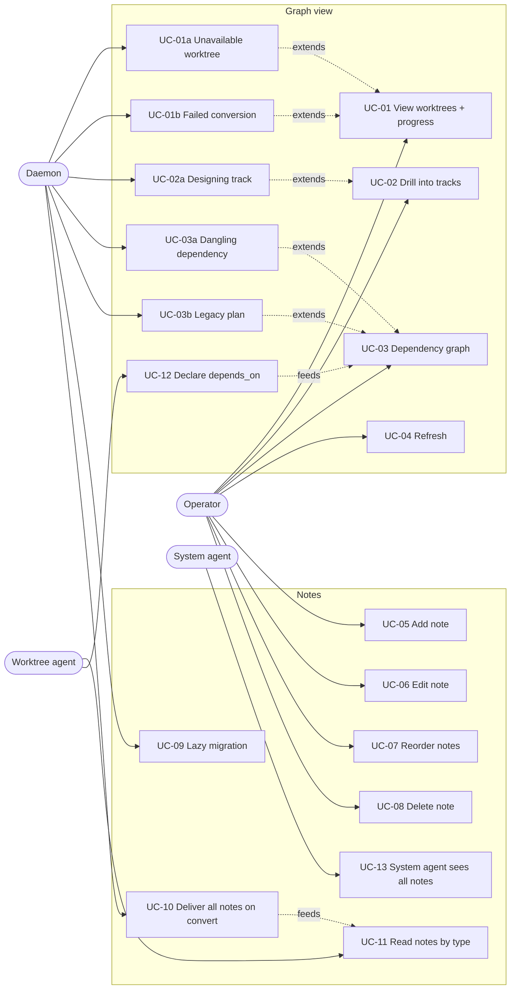
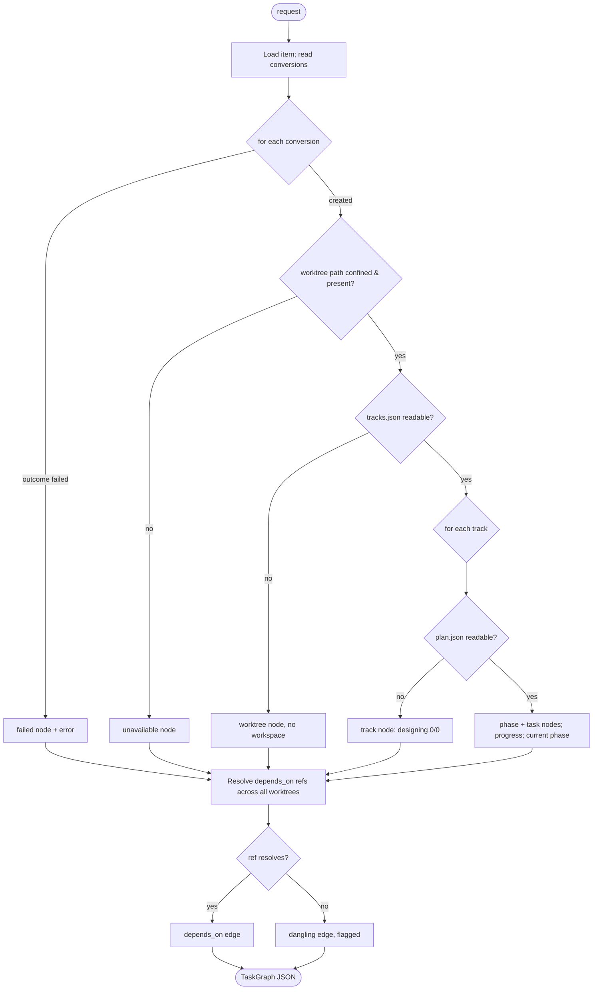
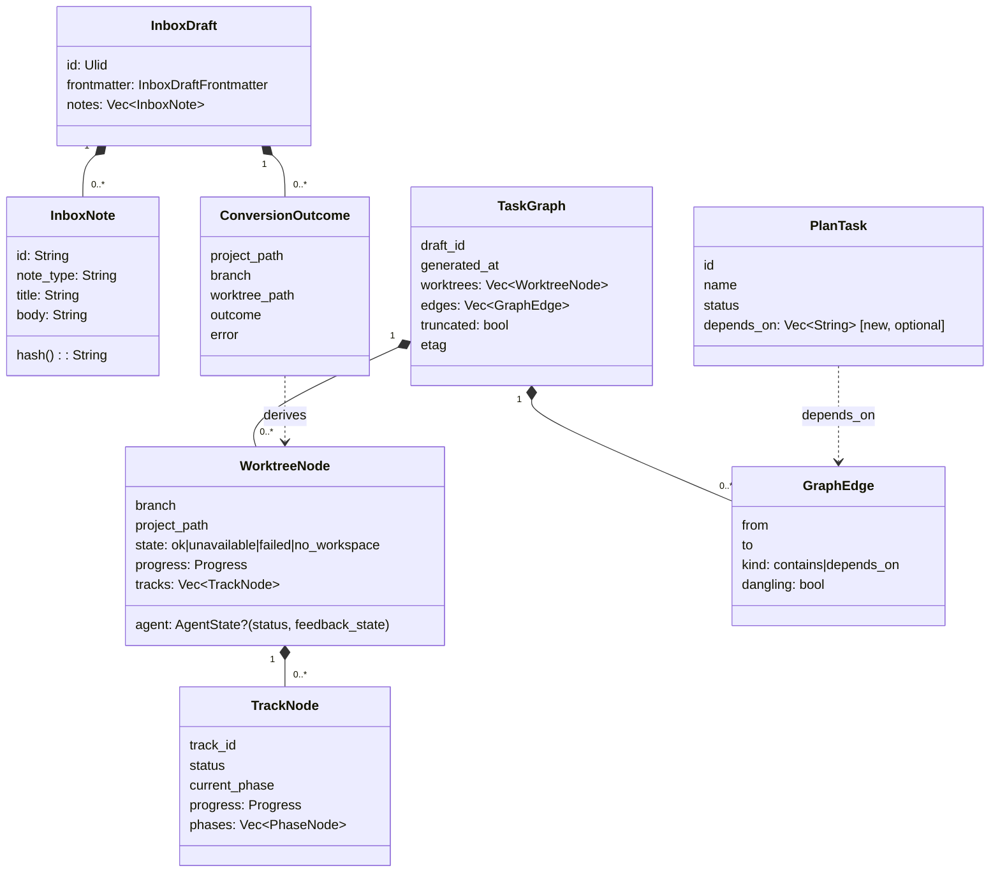
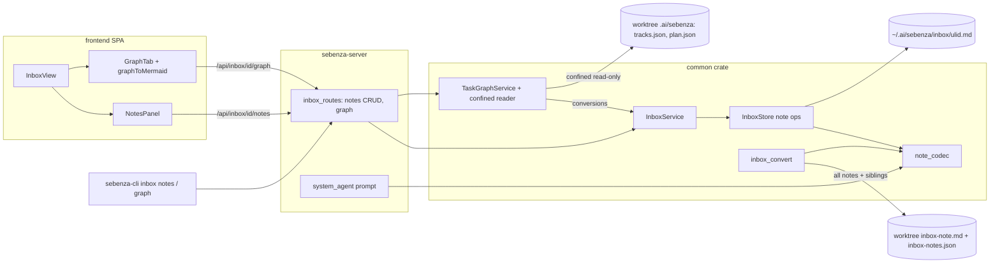
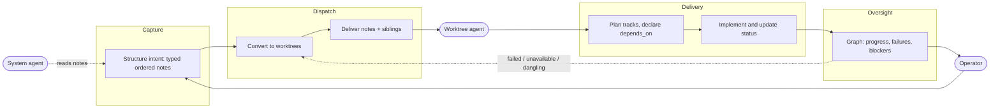
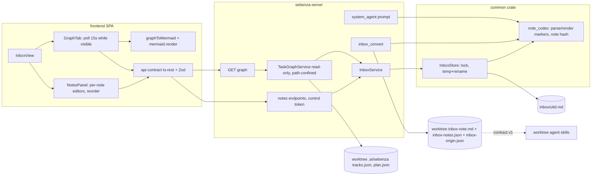
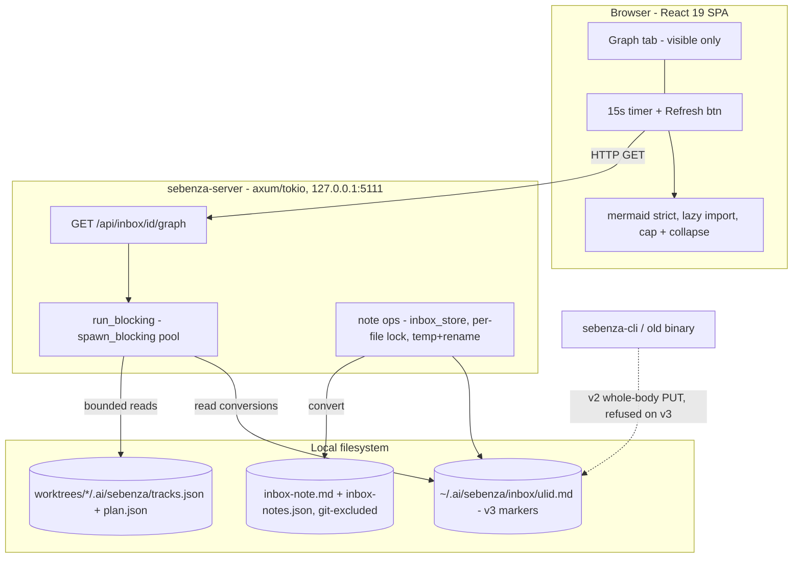
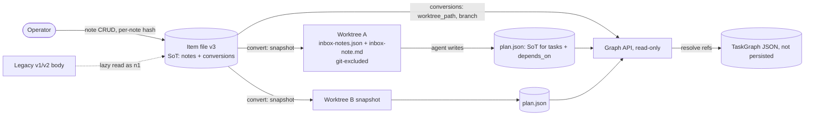
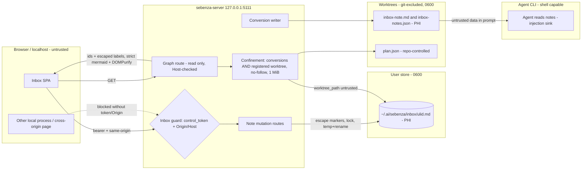

# Design: Inbox graph view & multiple notes

## Overview
Parts 1–2 of inbox item "Sebenza Task Graph" (P2). **Graph view**: a *Graph* tab shows the item's
worktrees, their tracks/phases/tasks with progress, and a dependency graph, derived read-only from
`conversions[]` and each worktree's `tracks.json`/`plan.json`. **Multiple notes**: an ordered list of
typed, titled notes (e.g. *Acceptance Criteria*), all delivered to worktree agents. Part 3
(requests/comments) is a separate bug track.

## Actors
- **Operator** — owns inbox items, reads the graph, writes notes.
- **Worktree agent** — the agent (and Sebenza skills) running in a converted worktree; reads notes, writes `plan.json`.
- **System agent** — the per-item inbox agent (draft-help, triage); reads notes.
- **Daemon** (system) — `sebenza-server`; stores items, builds the graph, performs conversion and migration.

## Use Cases
Primary flows are numbered `UC-nn`; alternate flows `UC-nna`.

| ID | Actor | Use case |
|---|---|---|
| UC-01 | Operator | View the item's worktrees, each with target project, overall progress and live agent state |
| UC-01a | Daemon | A recorded worktree is gone or unreadable → shown as an *unavailable* node, never dropped |
| UC-01b | Daemon | A conversion target failed → shown as a *failed* node with its recorded error |
| UC-02 | Operator | Drill into a worktree: tracks, phases, tasks, status, done/total, current phase |
| UC-02a | Daemon | A track has a design but no `plan.json` yet → shown as *designing*, 0/0 |
| UC-03 | Operator | View the dependency graph: worktree ⊃ track ⊃ task containment plus `depends_on` edges |
| UC-03a | Daemon | A `depends_on` ref resolves to no task → drawn as a flagged dangling edge |
| UC-03b | Daemon | A legacy plan without `depends_on` → containment only, no error |
| UC-04 | Operator | Refresh the graph (on open, on demand, and polled while the tab is visible) |
| UC-05 | Operator | Add a note with a title and type (e.g. `acceptance_criteria`) |
| UC-06 | Operator | Edit a note; a concurrent change to the same note is a conflict, other notes are not |
| UC-07 | Operator | Reorder notes |
| UC-08 | Operator | Delete a note |
| UC-09 | Daemon | Read a legacy single-body item as one note, lossless, without rewriting it |
| UC-10 | Daemon | Convert an item: deliver all notes (and sibling worktrees) to each worktree |
| UC-11 | Worktree agent | Read notes by type, e.g. the acceptance criteria |
| UC-12 | Worktree agent | Declare task dependencies (`depends_on`) in `plan.json`, incl. cross-worktree |
| UC-13 | System agent | Draft-help and triage see all notes, not only the first |

Diagram is a `flowchart LR` approximation of a UML use-case diagram.

## Activity
Building the graph for `GET /api/inbox/{id}/graph` (UC-01..UC-03).

## Class
New and changed entities. `InboxNote` lives inside the item file; graph types are response-only.

## Component

## Architecture

### Business Architecture

Typed notes let the operator state intent once (context, constraints, acceptance criteria) so agents
consume it by type. The Graph tab makes the inbox item accountable for its fan-out: what was spawned,
what failed, how far each track is, and what blocks what. Value: less status chasing, fewer conversions
without acceptance criteria, legacy items unchanged.

**Measures**: % of conversions with an `acceptance_criteria` note; % of an item's worktrees `ok` in the
graph; conversion `at` → first `plan.json`. **Roll-up**: done/total over `ok` worktrees, with failed and
unavailable counted beside it. **Remediation is manual** (re-convert); retry is out of scope.

**Decisions**
- Note type is an open slug. Sebenza (this repo's `note_codec` and the contract doc) owns the starter set (`general`, `acceptance_criteria`, `context`, `constraints`). No type is mandatory, and skills ignore types they do not know.
- Order is operator-defined: display order and `inbox-note.md` concatenation order. Agents select by type, not position.
- Only the operator (control token) mutates notes; agents and the system agent are read-only.
- Delete is hard and UI-confirmed; deleting the last note leaves one empty `general` note — never zero notes.
- Conversion snapshots notes; later edits do not reach existing worktrees. The graph is read-only oversight.

**Risks**
- Sibling contract slips → agents get notes only via concatenated `inbox-note.md`.
- The operator may assume note edits propagate after conversion. Mitigation: a "notes changed since conversion" badge, shown when the current `list_hash` differs from the `notes_list_hash` recorded on the conversion.
- Free-text notes may carry PHI, now copied into more files.
- Graph shows local file state; it may be read as authoritative delivery status.

### Application Architecture

**Placement**: `note_codec`, `InboxStore` note ops and `TaskGraphService` in `common`; routes in the server.
**Agent state**: `TaskGraphService` takes an `AgentStateLookup` port; the server implements it from the
manager's in-memory `WorktreeSnapshot` (`status`, `feedback_state`) — no tmux call or reconcile per poll;
unknown when the worktree has no runtime entry.

**Concurrency**: edit checks the note's `hash`; add/delete/reorder check `list_hash` (sha256 of ordered
`id:hash`), so edits to different notes never conflict (UC-06). Legacy body PUT keeps `body_hash`.

**Conversion seam**: `ConversionItem.body` becomes `notes: &[InboxNote]`, and
`ConversionRunner::write_note(path, body)` becomes `write_notes(path, &NotesBundle)`, which writes both
files. `run_conversion_item` computes `siblings` from the full target list before the wave starts. Each
`ConversionOutcome` records `notes_list_hash` and `note_types`, for the stale-notes badge and the business measures.

**SPA**: `NotesPanel` replaces `MarkdownEditor`, keeping `{body, hash}` per note; a 409 opens the merge
view for that note; DraftHelp's `proposed_body` replaces the selected note only. **CLI parity**: read-only
`inbox notes <id>` and `inbox graph <id>`.

| Route (mutations: control token) | Request | Success | Errors |
|---|---|---|---|
| `GET /api/inbox/{id}/notes` | – | `{notes:[{id,type,title,body,hash}], list_hash}` | 404 |
| `POST /api/inbox/{id}/notes` | `{type,title,body,after_id?,expected_list_hash}` | 201 note + `list_hash` | 400 slug/title, 409 |
| `PUT /api/inbox/{id}/notes/{nid}` | `{type?,title?,body?,expected_hash}` | note + new `hash` + `list_hash` | 409 `{current}`, 404 |
| `DELETE /api/inbox/{id}/notes/{nid}?expected_list_hash=` | – | 200 `{notes,list_hash}`; the last note is cleared to an empty `general` note | 409, 404 |
| `POST /api/inbox/{id}/notes:reorder` | `{order:[nid], expected_list_hash}` | `{notes,list_hash}` | 409; 400 if not a permutation |
| `PUT /api/inbox/{id}/body` (legacy) | unchanged | whole-body replace, re-parsed by codec | 409 if the re-parse would drop an existing note id |
| `GET /api/inbox/{id}/graph` | – | `TaskGraph` | 404 |

Node ids use the conversion index `<w>` (`conversions[]` is append-only), because one branch can exist in two projects: `w:<w>`, `t:<w>/<track>`,
`p:<w>/<track>/<phase>`, `k:<w>/<track>/<task>`, and `x:<ref>` for a dangling ref. They are never derived from `worktree_path`.

**Contract `inbox-notes.json` v1** (agree with agent-extensions-skills): `{schema:"sebenza-inbox-notes-v1",
draft_id, title, notes:[{id,type,title,body}] (operator order), siblings:[{branch,project_path}] (excl. self)}`.
`type` is `[a-z0-9_]{1,40}`; readers ignore unknown fields; v1 changes are additive; `inbox-note.md`
stays the fallback. Part 3 shares `inbox-origin.json` and defines the request/comment contract.

**Decisions**
- A pure `note_codec` (common) is the only marker parser/renderer, used by store, convert and system agent.
- Malformed or duplicate-id markers stay body text; nothing is dropped.
- Server emits structure; the SPA owns Mermaid rendering.

**Risks**
- Marker-lookalike lines in note bodies could forge or split notes (see Data and Security).
- A legacy whole-body PUT from an old client can rewrite note ids.
- The contract can drift from agent-extensions-skills. Mitigate with a shared fixture file.

### Technical Architecture

No new infrastructure, crates or npm dependencies. The graph route does its reads in `run_blocking`;
nothing is cached. **Refresh decision:** fetch on tab open and Refresh, then poll every 15 s only while
the tab is visible — one request in flight, aborted on hide/unmount; a failed or torn-JSON read keeps
the last good graph marked stale; an unchanged response skips the mermaid re-render. v3 needs no
migration job; older binaries read it but refuse to write it (`require_writable` guards `save_body`).

**Decisions**
- Target: p95 under 300 ms at the caps (25 worktrees, 2,000 nodes). Past a cap the over-limit worktrees return counts only (`truncated: true`).
- Caps: skip any JSON file over 1 MiB, with an error code per worktree. Never a 500. The response `etag` is computed from (path, mtime, size) of the item file and every worktree file before parsing, so `If-None-Match` returns 304 without a parse.
- Collapse a track to one summary node above 150 nodes or 400 edges, with expand on click. `maxEdges` and `maxTextSize` are set explicitly, and a render test covers them.
- `depends_on` is optional (`#[serde(default)]`), and the CLI and old binaries ignore it.

- Lock-free readers tolerate torn reads; a `tracing` span logs build time, truncation, unavailable counts; rollback = downgrade (v3 items read-only there).

**Risks**
- A large mermaid render blocks the main thread. The collapse thresholds need measuring on low-end hardware.
- Many tabs polling at once can contend for the `spawn_blocking` pool on slow disks. The caps and the single in-flight request bound this.
- `plan.schema.json` lives in another repo, and no CI check ties the two repos together.

### Data Architecture

The item file is the source of truth for notes and `conversions[]`, and `plan.json` is the source of
truth for tasks. The copies in worktrees are one-way snapshots. Grammar:

| Element | Rule |
|---|---|
| Marker | `<!-- sebenza:note id=<nid> type=<slug> title="<json-escaped>" -->`, strict regex, column 0; title escapes `<` `>` `"` |
| Note id | `[a-z0-9]{2,16}`; legacy `n1`; new ids 8 random base32, collision-checked against the item's ids |
| Body escape (v3) | write: a line matching `^\\*<!-- sebenza:note` gains one leading `\`; read: a line matching `^\\+<!-- sebenza:note` loses exactly one |
| Preamble | v3 text before the first marker becomes a `general` note "Note" with deterministic id `p` + 8 hex of sha256(text), persisted on the next write |
| Line endings | CRLF → LF on write; `hash` = sha256(type, title, body); legacy `body_hash` covers the whole raw body incl. markers |
| `depends_on` ref | `["@" branch ":"] [track "/"] task`; ids `[A-Za-z0-9_.-]{1,64}`; no `@` = same worktree, no `/` = same track |

**Migration.** A pre-v3 body reads as one note (`n1`, `general`, "Note"), unrewritten. Because
`require_writable` stamps the version on *every* write, any v2→v3 stamp also rewrites the body as an
explicit, escaped `n1` in the same atomic write — lossless whatever triggers it.

**Retention.** Note delete purges its text; event lines hold ids/hashes only; worktree copies live and
die with the worktree (accepted risk).

| Entity / field | Class | Note |
|---|---|---|
| Note `body`, `title` | PHI-possible, confidential | Free text; PhiNotice applies |
| Note `type`, `id`, `hash`, `schema_version` | Internal | |
| Item `title`, `conversions[].prompt` | PHI-possible | May echo note text |
| `conversions[]` paths, branch | Internal | Local paths |
| `conversions[].error`, `plan.json` task/track names | Possibly sensitive | Free text; graph returns an error code, names escaped and capped |
| `inbox-note.md`, `inbox-notes.json` | PHI-possible copies | Same class as the source |
| `plan.json` ids, `depends_on` | Internal | |
| Graph response | Internal | Task/track names only; never note bodies |

**Decisions**
- Escaping is reversible and v3-gated; the v2→v3 stamp always materialises `n1` with escaping.
- `conversions[]` becomes append-only: `apply_patch` merges a Job's conversions by appending, never replacing, so the index is a stable graph key.
- `depends_on` grammar: `@branch:` splits at the first `:` (branch names cannot contain `:`), and `track/task` splits at the last `/`.
- An unresolved, ambiguous (one branch in two projects) or cyclic ref becomes a flagged edge, never an error.
- `siblings` in `inbox-notes.json` is only a hint. The graph always resolves refs from `conversions`.

**Risks**
- Deleting a note or item does not purge the worktree copies, so PHI stays for the worktree's lifetime.
- A hand-edited malformed marker degrades to body text and can merge a note into its neighbour. A round-trip test and a warning cover this.

### Security Architecture

- **Mutations**: every note route and the body PUT use the existing inbox guard (token, Origin, Host).
- **Graph GET**: like other inbox reads — no token, Host-checked, never writes.
- **Confinement**: canonical `worktree_path` must be in this item's `conversions[]` *and* in
  `GitAdapter::list_worktrees` of a `sebenza_registry` project. Ids from repo-controlled `tracks.json`
  must match `[A-Za-z0-9_.-]{1,64}` and join under canonical `.ai/sebenza/tracks/`; files open
  `O_NOFOLLOW` relative to that parent (no TOCTOU), ≤1 MiB. `fs::read_tracks` is not used.
- **Graph payload**: fixed error codes only (`missing`, `unreadable`, `too_large`, `invalid_json`,
  `not_registered`, `conversion_failed`) — never file paths inside worktrees, recorded errors or note text
  (the worktree's own `project_path`/`branch` are Internal and shown).
- **Markers**: escaped per Data; every write re-parses and requires ids to round-trip (fuzz-tested).
- **Rendering**: generated ids, labels escaped and capped at 80 chars, mermaid `strict`, DOMPurify.
- **Agents**: new worktree files git-excluded, `0600`; notes reach agents labelled as untrusted data.

| ID | STRIDE | Threat | Severity | Mitigation |
|---|---|---|---|---|
| T-01 | Elevation | Forged or cross-origin note mutation that later steers an agent | High | Inbox guard on every note route and the body PUT; route-registration test |
| T-02 | Info disclosure | A crafted `worktree_path` or `track_id` (traversal, absolute path or symlink) makes the graph read arbitrary files | High | conversions ∩ registry worktrees, canonicalize, id pattern, `O_NOFOLLOW` under canonical parent, error codes only |
| T-03 | DoS | Huge or cyclic `plan.json` or many conversions exhausts the daemon | Medium | 1 MiB, 25-worktree and 2,000-node caps; cycle-safe resolution; visible-only poll |
| T-04 | Tampering | A forged marker in a body or title splits or overwrites notes | Medium | Title escape, body-line escape, round-trip check, per-note hash |
| T-05 | Tampering | XSS through mermaid labels from `plan.json` names, branches or note titles | High | Generated ids, escaped and capped labels, `strict`, DOMPurify, titles rendered as text |
| T-06 | Info disclosure | PHI in worktree copies gets committed or read by other users | Medium | Both files in `WRITTEN_REL_PATHS` (git exclude), `0600`; tests assert this |
| T-07 | Elevation | Instructions injected via notes drive a shell-capable agent | High | Notes delimited and marked as untrusted data; JSON contract is data-only; extends T-006 |
| T-08 | Info disclosure | An `@branch:` ref reaches outside the item | Medium | Refs resolve only against this item's conversions; no filesystem lookup by ref |
| T-09 | Repudiation | Note edits and deletes leave no trail | Low | Event-log line per note op (note id, op, hashes, request id, caller marker), never title or body text |

T-01..T-09 are local ids, re-numbered at close-out (T-001..T-015 exist).

**Compliance**: HIPAA minimum-necessary, access and audit safeguards apply to PHI-possible notes: local,
`0600`, git-excluded, never logged. Sebenza is not a PHI system of record.

**Risks**
- T-010 (an unauthenticated control plane) remains, so any local process can read the graph.
- Prompt injection (T-006/T-07) is only bounded by sandboxing.
- `plan.json` is repo-controlled, so sanitising must hold on every render path.
- Skills in the sibling repo may ignore the data-only nature of `inbox-notes.json`.

## Impact Analysis

- `common`: `note_codec`; `InboxDraft` notes; schema 2 → 3, stamp via codec.
- `common`: `InboxStore` note ops, `list_hash`; `save_body` guards note ids.
- `common`: `TaskGraphService`, confined reader, `depends_on` resolver.
- `inbox_convert`: notes in `ConversionItem`, `write_notes`, `siblings`, `notes_list_hash`, 3 excluded files.
- `sebenza-server`: 5 note routes, graph route; system-agent prompt gets all notes.
- `frontend`: `NotesPanel`, `GraphTab`, `graphToMermaid`, contract, `api.ts`.
- `sebenza-cli`: read-only `inbox notes`, `inbox graph`.
- **Cross-repo** (agent-extensions-skills): `depends_on` in `plan.schema.json`; skills read `inbox-notes.json`; shared fixtures.
- `SECURITY.md`: threats consolidated at close-out.

## Open Questions for Refinement
- Resolved at planning (2026-11-05): caps kept, p95 measured manually; fixtures canonical in this repo
  (`crates/common/testdata/contracts/`), sibling copies; live agent state included; PHI = warn only.
- Validate `depends_on` refs skill-side as well as in the daemon? (sibling worktree's call)
