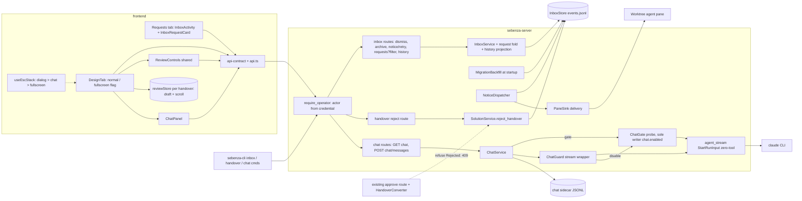

# Application Architecture — Sebenza Polishing

Back to [design.md](./design.md).

## Narrative
Three slices, each extending an existing seam; no new store.

**Requests.** `InboxService` gains `dismiss_request`, `archive_request`, `retry_notice`, a `RequestFilter` on `list_requests` and a `request_history` projection. Every action validates the folded state and appends under the per-item lock (409 on a disallowed transition). Existing `confirm`, `reject`, `redeliver` and `retry-triage` return 409 on a dismissed request. A `NoticeDispatcher` task sends pending dismissal notices through `PaneSink` and records each attempt; it never writes status. A startup `MigrationBackfill` appends one `migrated` event per pre-existing request.

**Reject.** `SolutionService::reject_handover` applies only to a `Drafted` or `Deferred` handover (awaiting review). There is no dispatch queue: approval converts synchronously (`HandoverConverter`), so "cancel pending dispatch" means `approve_handover` and conversion refuse a Rejected handover (409). Only `wrong_project` adds a `design_revision_requested{project, reason}` to the same line (one branch, easy to change, pending operator confirmation); the project is not removed automatically.

**Chat.** `ChatService` is a new `agent_stream` caller, pinned to the `claude` provider. On every call it re-checks the operator session and that the handover exists in that item. `ChatGate` owns `chat.enabled`: only the probe can enable it; `ChatGuard` calls `disable()` on any tool event. Threads live in a chat sidecar, not `events.jsonl`.

## Diagram

## Decisions
1. Request routes: `POST /api/inbox/{id}/requests/{rid}/dismiss|archive|notice/retry`, `GET .../requests?filter=unanswered|answered|dismissed|all` (default all), `GET .../requests/{rid}/history`; wrong status → 409.
2. Handover routes (a deviation from the handover's `/handovers/{id}/…`, raised to the operator) follow the existing `/api/inbox/{id}/handover/{project}/…` shape: `POST …/reject {reason, comment}`, `GET …/chat`, `POST …/chat/messages {text}`; chat id = `{id}:{project}`. Request `…/requests/{rid}/reject` (existing) and handover `…/reject` are distinct actions, named distinctly in UI and CLI.
3. A dismiss is one `request_dismissed` JSONL line that is also the outbox enqueue and carries `cancels_redelivery`; archive and reject are single events (schemas in [data](./data-architecture.md)).
4. Chat lives in a per-handover chat log outside the solution fold. `ChatService` builds its own `StartRunInput`; other `agent_stream` callers are untouched.
5. `reviewStore` is keyed `inboxId:project`. `useEscStack` is one global keydown listener with a layer registry, and `BaseDialog` registers in it.

## Risks
- A `migrated` backfill append could interleave with live appends; take the per-path mutex.
- Dispatcher and manual Retry could double-send; idempotency key + `append_event_once` on attempt number.
- The `claude` CLI output is unversioned in the daemon; an upgrade fails the probe closed (acceptable, needs version detection).
- `wrong_project` → Revising must pass `can_move_to` before the single append, or the reject is refused whole; the Rejected check and append run under `with_item_lock`, like approve.
- Native `<dialog>` handles Esc itself; unless it registers in the stack, outer layers close early.
