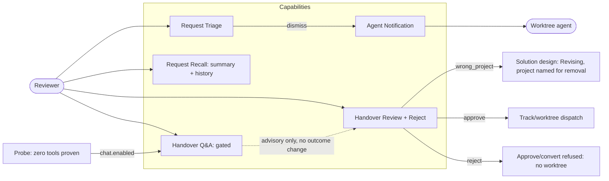

# Business Architecture — Sebenza Polishing

Back to [design.md](./design.md).

## Narrative
Polishes the two surfaces where the Reviewer governs agent work: the Requests tab and handover review. Goals: a bounded inbox and a safer, faster review decision.

**Capabilities:** Request Triage, Request Recall, Agent Notification, Handover Review (full screen, Reject), Handover Q&A (chat).

**Business rules:**
- Filters: Unanswered = open, proposed, delivery_failed*; Answered = confirmed, resolved; Dismissed; All. Dismiss only from Unanswered; archive only from Answered, as a flag. v1 has no restore, unarchive or Archived filter.
- Nothing is deleted (NFR-03). Notice outcomes never change request status.
- `wrong_project` reject marks the design for revision (Revising*) and names the project to remove; owner of the revision TBD*.
- Chat is advisory and read-only: one shared thread per handover*, every message authored, kept but never part of the review record.

\* Pending owner confirmation (handover §6); see [Open Questions](./design.md#open-questions-for-refinement).

**Release order:** Requests, reject and full screen ship first; chat ships only when the probe passes and AC-07a/b is approved.

**Org impact:** the Reviewer, from the session, is the sole accountable actor. Agents get an explicit "dismissed" signal. UI and CLI parity.

## Diagram

## Decisions
1. Archive is a flag over answered requests; no restore in v1.
2. Dismissal notices go through an outbox, separate from status; `delivery_failed` keeps its meaning.
3. Reject only while awaiting review; `wrong_project` is fixed at design level, not patched downstream.
4. Chat fails closed with no fallback: availability is traded for a structural no-influence guarantee.
5. Summaries are template-derived, not LLM-generated: deterministic, cheap, no extra disclosure.

## Risks
- Once a notice is failed after max attempts, a blocked agent waits until the operator uses Retry.
- Reviewers may treat chat as authoritative; the UI must say chat is not part of the review record.
- A CLI upgrade disables chat until re-probe; the operator needs a visible chat status.
- AC-07a/b amendment is pending owner approval; rejection changes chat scope or release.
- Template summaries may be too terse to be useful; no success metric is defined.
