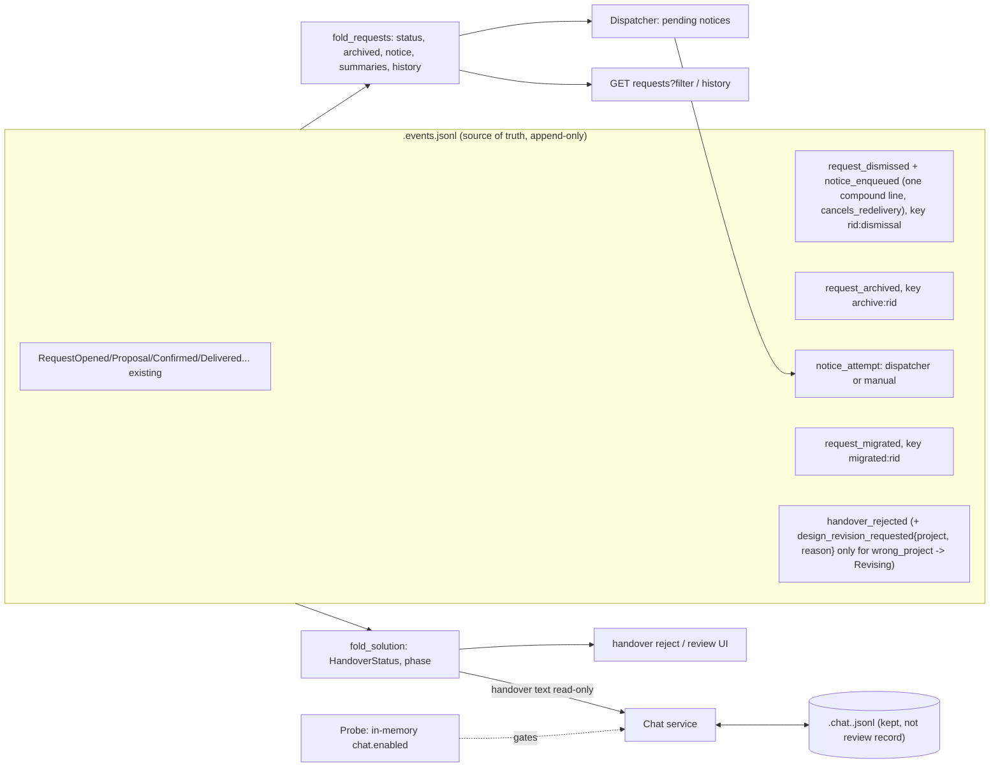

# Data Architecture — Sebenza Polishing

Back to [design.md](./design.md).

## Narrative
There is no database. The handover's tables map onto each item's append-only `<id>.events.jsonl`.

- **Transaction = one line.** `request_dismissed` holds the status change, the history row, the outbox enqueue and the redelivery cancel. A failed write records nothing.
- **Folds.** `fold_requests` adds `Dismissed`, `archived_at/by`, notice state, derived summaries (title-only, ≤140 characters) and history. `fold_solution` adds `HandoverStatus::Rejected`.
- **Reject** applies only to `Drafted`/`Deferred`. One line carries `handover_rejected` and, only for `wrong_project`, a `design_revision_requested{project, reason}` that moves the solution to Revising; the project is never removed automatically. A rejected handover is never approved or converted.
- **Outbox** state is folded from the log, and the dispatcher keeps an in-memory pending index.
- **Chat** goes in a sidecar `<id>.chat.<slug>.jsonl` (0600, same per-path mutex), outside the approval hash and the review record. `chat.enabled` is memory-only.

## Diagram

All events carry the existing envelope (`ts`, `author{kind, caller}`, `schema_version`); the actor is `author`.

| Event (log type) | Payload | Key | History `kind` (contract) |
|---|---|---|---|
| `request_dismissed` + `notice_enqueued` (one compound line) | `request_id, from, cancels_redelivery`; enqueue carries outbox key `request_id:dismissal` | `{rid}:dismissal` | `dismissed`, `notice_enqueued` |
| `request_archived` | `request_id, status_at_archive` | `archive:{rid}` | `archived` |
| `notice_attempt` | `request_id, attempt, trigger: dispatcher\|manual, outcome: started\|sent\|retry\|failed, error?` | `notice:{rid}:{n}:{outcome}` | `notice_attempt` |
| `request_migrated` | `request_id, status` | `migrated:{rid}` | `migrated` |
| `handover_rejected` (+ `design_revision_requested{project, reason}` only when `wrong_project`, same line) | `project, reason, comment` | `reject:{project}:{draft_hash}` | solution event, not request history |
| existing open/proposal/confirm/deliver | unchanged | existing | projected `created` / `status_changed` |

Chat sidecar line: `schema_version, message_id, ts, author, role: reviewer\|agent\|aborted, text, instruction_hash`. Key `{id}:{project}`; the file name uses the validated project slug.

| Filter | Statuses | Archived rows |
|---|---|---|
| unanswered | open, proposed, delivery_failed | n/a |
| answered | confirmed, resolved | included, flagged |
| dismissed | dismissed | n/a |
| all | every status | included |

## Decisions
1. Validate-then-append runs under the per-item lock; new kinds use a durable append (single write + fsync, other callers unchanged), and the fold ignores a torn final line. Kinds are additive, snake_case, `schema_version` 1, idempotent via `append_event_once` keys (`{rid}:dismissal`, `archive:`, `migrated:`; backfill checks for an existing `migrated` event first).
2. Dismissed is terminal in the fold. A late `Delivered`/`DeliveryFailed` stays in history only, and `redeliver()` refuses `Dismissed`.
3. Pending notice = `notice_enqueued` with no successful `notice_attempt`; rebuilt from the log at startup and retried (an interrupted `started` is retried; the key in the notice text lets the agent ignore a duplicate). `failed` after `notify.max_attempts`; manual Retry appends a `notice_attempt{trigger: manual}`. `next_attempt_at` is the last attempt's `ts` plus the backoff, computed and never stored. Notice events never touch `RequestStatus`.
4. History merges a projected `created` row, projected `status_changed` rows and the real events. `migrated` uses actor `system:migration` and `ts` = now.
5. Chat lines record `author`, `role` and the handover `instruction_hash`. Aborted turns write a content-free marker. Nothing is ever truncated or deleted (NFR-03).

## Risks
- Re-folding the whole log on every poll scales with history; mitigated by the in-memory pending index.
- A path using plain `append_event` for keyed kinds would duplicate them; a unit test must fail on missing keys.
- `append_event_once` re-reads the whole log per keyed append; add a derived fold-snapshot cache if a log passes 10 MB; the log itself is never compacted.
- Titles, chat and handovers can carry agent-pasted secrets; files are 0600 and summaries are title-only.
- The chat file slug could collide or allow path traversal; validate it like `solution_dir` names.

## Classification
Not designed to hold PHI. Agent- and operator-written text may contain it, or secrets, incidentally, so that text is Confidential. Titles are immutable after `RequestOpened`, which keeps summaries stable.

| Entity / field | Class | Notes |
|---|---|---|
| Request title/body/answer text | Confidential (may hold secrets) | existing scan warnings |
| `summary_request` / `summary_result` | Confidential (derived) | not stored; title only |
| Request events, outbox state, `archived_at/by` | Internal | audit |
| `notice_attempt.error` | Internal | truncated; may leak paths |
| Reject `comment` / `reason` | Confidential | |
| Chat messages | Confidential | retained; not review record |
| Capability `{enabled, cli_version, probed_at}` | Internal | `enabled` memory-only |
