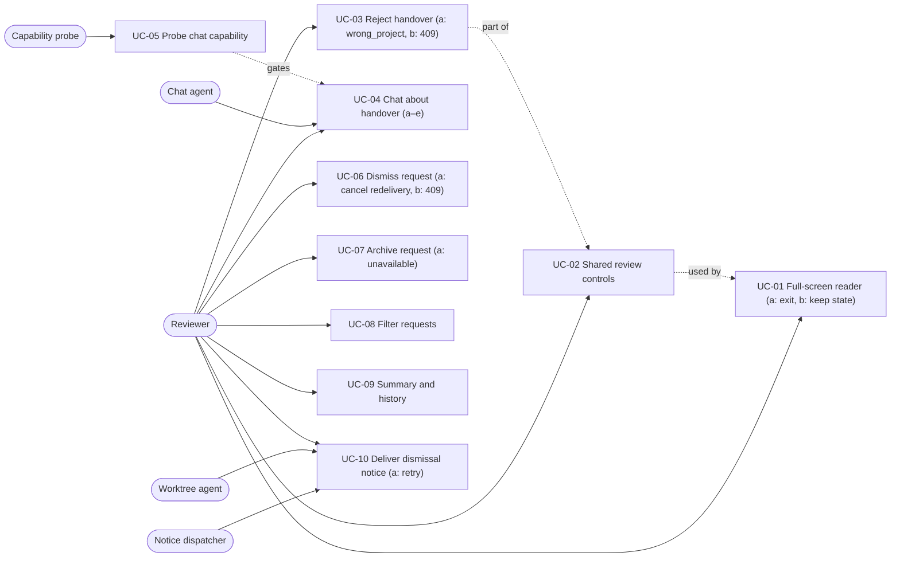
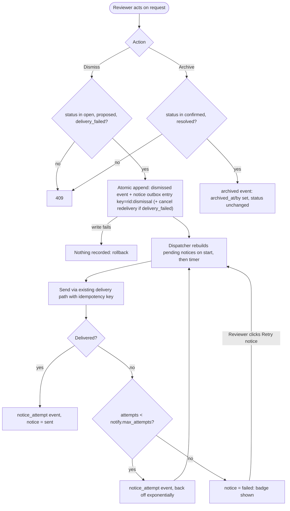
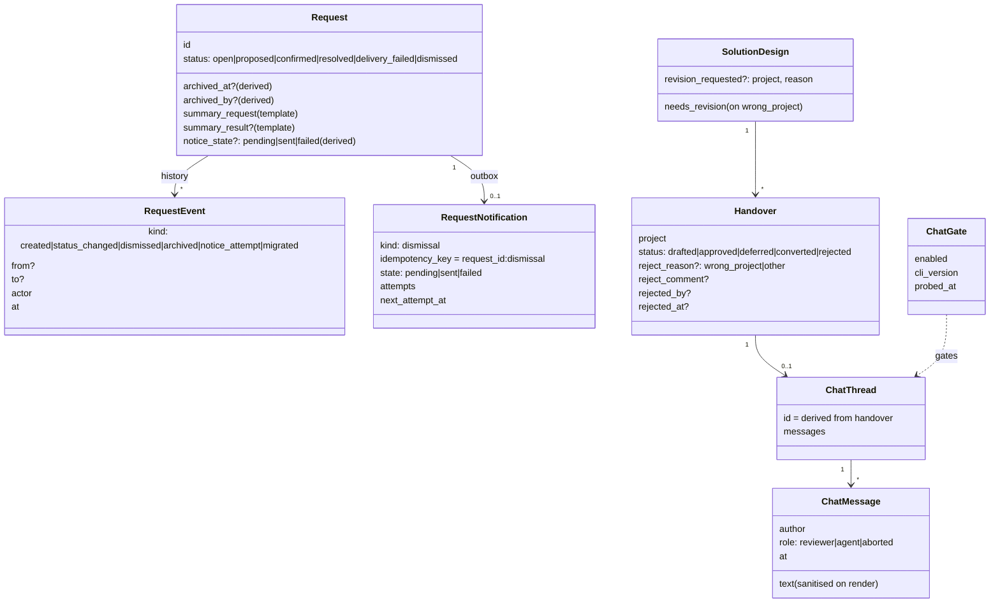

# Design — Sebenza Polishing

Source: inbox item "Sebenza Polishing" and the operator-approved [solution handover](../../solution-handover.md).

## Overview
Polishes the two operator surfaces that the first factory release exposed: the **Requests tab** and **handover review**. Requests gain a `dismissed` status, archive flags, template summaries, an append-only history and a transactional dismissal-notice outbox. Handover review gains a shared review-controls component, a **Reject** action with a reason, a full-screen reading mode with layered Esc, and a read-only **chat** with a zero-tool agent that stays behind a fail-closed capability probe. Built in the handover's order (§5): Requests and reject/full screen ship first; chat ships only behind `chat.enabled`.

## Actors
- **Reviewer** (human operator, from the session) — reviews handovers, chats, manages requests.
- **Worktree agent** — raises requests through `sebenza-agentctl`; receives answers and dismissal notices.
- **Notice dispatcher** (system) — delivers dismissal notices from the outbox.
- **Capability probe** (system) — proves the chat run has zero tools; sole writer of `chat.enabled`.
- **Chat agent** (system, headless `claude`) — answers questions about one handover, no tools.

## Use Cases
Traces the "Acceptance Criteria (draft)" inbox note (items 1–10) and handover AC-01…AC-12 plus reject.

| ID | Use case | Actor | Traces |
|---|---|---|---|
| UC-01 | Open a handover in full screen | Reviewer | AC note 1; AC-01 |
| UC-01a | Leave full screen by button or layered Esc (dialog → chat → full screen) | Reviewer | AC note 3; AC-03 |
| UC-01b | Toggle modes without losing review input or scroll position | Reviewer | AC-04 |
| UC-02 | Use the same review controls in either mode | Reviewer | AC note 2; AC-02 |
| UC-03 | Reject a handover with reason and comment | Reviewer | AC-02; reject addendum |
| UC-03a | Reject as `wrong_project`: design marked `needs_revision` | Reviewer | reject addendum |
| UC-03b | Reject when not awaiting review → 409 | Reviewer | reject addendum |
| UC-04 | Chat with an agent about the handover under review | Reviewer, Chat agent | AC note 4–5; AC-05, AC-06 |
| UC-04a | Chat unavailable (probe failed/stale) → 503, entry hidden | Reviewer | AC-07a |
| UC-04b | Handover too large or transcript full → refused / 413 | Reviewer | AC-05 |
| UC-04c | Tool activity in a turn → guard aborts, chat disabled | Chat agent | AC-07a |
| UC-04d | No session / no access / access revoked mid-chat → denied | Reviewer | AC-06 |
| UC-04e | Embedded instructions in a handover do not change the agent's role | Chat agent | AC-07b |
| UC-05 | Probe chat capability at start and on CLI version change | Capability probe | AC-07a |
| UC-06 | Dismiss a request | Reviewer | AC note 6; AC-08 |
| UC-06a | Dismiss a `delivery_failed` request: redelivery cancelled | Reviewer | AC-08 |
| UC-06b | Dismiss from a non-dismissable status → 409 | Reviewer | AC-08 |
| UC-07 | Archive a confirmed or resolved request | Reviewer | AC note 7; AC-09 |
| UC-07a | Archive unavailable for other statuses (disabled, 409) | Reviewer | AC-09 |
| UC-08 | Filter requests: Unanswered, Answered, Dismissed, All | Reviewer | AC note 8; AC-10 |
| UC-09 | Read a request's summary and history, incl. archived/dismissed | Reviewer | AC note 9–10; AC-11, AC-12 |
| UC-10 | Deliver a dismissal notice through the outbox | Notice dispatcher, Worktree agent | AC-08 |
| UC-10a | Notice fails after max attempts → badge, Reviewer retries | Reviewer | AC-08 |

Approximation: `flowchart LR` stands in for a UML use-case diagram.



## Activity
Request lifecycle and dismissal-notice outbox (UC-06, UC-07, UC-10). Each "commit" is one atomic append to the item's `events.jsonl`, which stands in for the handover's single transaction (see Open Questions).



## Class
New or changed entities. Requests and solutions stay event-sourced from append-only JSONL; "derived" fields come from the fold.



## Component
```mermaid
flowchart LR
  subgraph SPA[frontend SPA]
    RT[Requests tab: InboxActivity + InboxRequestCard]
    HR[Handover review: DesignTab, normal / full-screen mode]
    RC[Shared ReviewControls incl. Reject]
    CPn[Chat panel]
    ESC[Layered Esc manager]
    RS[(review state store, per handover)]
  end
  CLI[sebenza-cli]
  subgraph D[sebenza-server daemon]
    IR[inbox routes: dismiss, archive, notice/retry, filter, history]
    SR[solution routes: handover reject]
    CR[chat routes: GET thread, POST message]
    IS[InboxService + request fold]
    ND[Notice dispatcher]
    SS[Solution service]
    CS[Chat service]
    PG[Capability probe + runtime guard]
    AS[agent_stream]
    DP[existing delivery path: PaneSink]
  end
  ST[(InboxStore: item doc + events.jsonl)]
  CC[claude CLI, zero tools]
  WT[Worktree agent pane]
  RT --> IR
  HR --> RC --> SR
  HR --> CPn --> CR
  ESC -.-> HR
  HR --> RS
  CLI --> IR & SR & CR
  IR --> IS --> ST
  ND --> ST
  ND --> DP --> WT
  SR --> SS --> ST
  CR --> CS --> AS --> CC
  PG --> AS
  PG -. chat.enabled .-> CS
  CS --> ST
```

## Architecture
| Domain | Document | In scope |
|---|---|---|
| Business | [business-architecture.md](./business-architecture.md) | yes |
| Application | [application-architecture.md](./application-architecture.md) | yes |
| Technical | [technical-architecture.md](./technical-architecture.md) | yes |
| Data | [data-architecture.md](./data-architecture.md) | yes |
| Security | [security-architecture.md](./security-architecture.md) | yes |

## Impact Analysis
- `crates/common/src/domain/inbox_events.rs`: `Dismissed` status, new event kinds, fold for archive/notice/summaries/history.
- `crates/common/src/services/inbox_service.rs`: dismiss, archive, retry_notice, filtered list, history; `redeliver` refuses Dismissed.
- New notice dispatcher task and startup backfill in `sebenza-server`.
- `crates/common/src/domain/solution.rs` + `services/solution.rs`: `HandoverStatus::Rejected`, `reject_handover`, `wrong_project` → Revising.
- `agent_stream.rs`: one additive optional `ToolPolicy` field; new `ChatService`, `ChatGate` probe and guard.
- Existing request routes return 409 on Dismissed; `approve_handover`/conversion refuse Rejected (this is the dispatch cancel: approval converts synchronously, no queue).
- New routes in `server.rs`, ts-rest `contract.ts` and `api.ts`, and matching `sebenza-cli` commands.
- Frontend: `InboxActivity`/`InboxRequestCard` (actions, filters, summary, history, notice badge); `DesignTab` split into shared `ReviewControls`, full-screen mode, `reviewStore`, `useEscStack`, `ChatPanel`.
- Config: `NotifyConfig`, `ChatConfig`; `SECURITY.md` register gains the chat threats at close-out.
- Release gate: chat is built but not released until the probe passes and AC-07a/b is approved.

## Open Questions for Refinement
1. [Operator, answered 2026-11-15] JSONL mapping confirmed with lock+fsync, startup outbox rebuild, idempotent backfill; reject path `/api/inbox/{id}/handover/{project}/reject` and the `--tools ""` field approved (2026-11-15). Design approved.
2. [Handover §6] Is the AC-07a/AC-07b amendment approved? This blocks the chat release.
3. [Handover §6] Confirm that a `wrong_project` reject marks the design `needs_revision` (mapped to Revising).
4. [Handover §6] Confirm that `delivery_failed` belongs under Unanswered.
5. [Handover §6] Confirm that a shared chat thread per handover is acceptable.
6. Retry notice while `pending`: proposed 409; stuck-agent alert beyond the badge?
7. Does the pinned `claude` CLI support `--tools ""`, report its tools in `init`, and honour `disableAllHooks`?
8. Replay CI proves only the harness: is the live 60×3 run (TS-18, ~180 calls) the AC-07b release gate rather than per-PR?
9. After a `wrong_project` reject, who removes the project and re-reviews the other handovers?
10. `solution-design.md` is absent from this worktree; the design is built from the handover alone.
