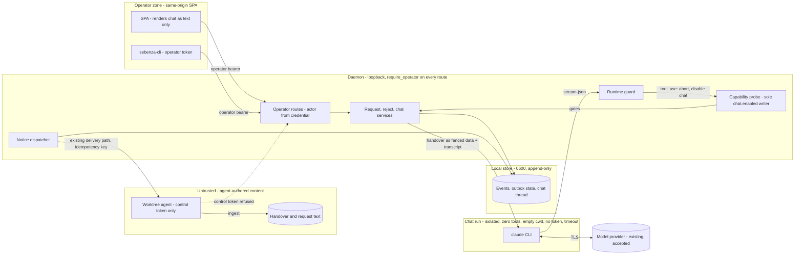

# Security Architecture — Sebenza Polishing

Back to [design.md](./design.md). Extends the project register in [SECURITY.md](../../SECURITY.md).

## Narrative
Every new route calls `require_operator`: the control token gets an audited 403, and the actor comes from the credential, never the body. Loopback only, no new external service (NFR-02).

The chat is the new attack surface, since the handover is agent-authored and may carry injected instructions. The primary control is structural: no tools, no MCP, no token, empty cwd, no mutation route. The fenced-untrusted-data prompt is secondary. The probe (sole writer of `chat.enabled`) fails closed. The runtime guard is detective, since `tool_use` arrives after the attempt, so the zero-tool structure must hold on its own. Output renders as a plain text node, so it cannot exfiltrate or inject script.

## Diagram

## Decisions
1. `require_operator` (host + origin check, operator credential) runs before any state read on every new route; the actor comes from the credential.
2. The chat `StartRunInput` comes from one asserted constructor:
   - isolated, with an env allowlist and no control or operator token;
   - `strict_mcp`, empty cwd, timeout, no resume;
   - `permission_mode` never permissive, `--settings` with `disableAllHooks`;
   - every built-in denied, plus `--tools ""` via a new optional `ToolPolicy` field (None elsewhere; existing role-agent argv byte-identical, tested);
   - provider pinned to `claude` at the probe-resolved absolute path; any other provider is refused.
3. An empty `allowed` list emits no flag, which means CLI defaults rather than none. Denial must therefore be explicit, and the probe proves it.
4. Handover and transcript are fenced with a per-turn random delimiter, escaped if present. Oversized handovers are refused, never truncated.
5. Output renders as a text node only, with no `dangerouslySetInnerHTML`. Audit lines carry ids and actors, never message bodies.

## Risks
- A CLI update adds an unnamed built-in; only the probe on a version change catches it.
- The guard is detective; the structural zero-tool setup is the real control.
- T-024/T-025 are unchanged: a same-uid agent can mint an operator token and act as the operator.
- Handover and chat text (which may hold secrets) reach the model provider each turn (T-005) and stay on disk.
- Injection can still bias answers; only the AC-07b evaluation bounds this.

## Threat Model
| STRIDE | Threat | Boundary | Sev | Lik | Mitigation |
|---|---|---|---|---|---|
| E | Injected handover makes chat call a tool or change an outcome | Chat agent ↔ daemon/worktree | Critical | Low | Zero-tool run, fail-closed probe, guard, no mutation route, no token, empty cwd |
| E | Built-in tool enabled (empty allow = defaults, new CLI tool, non-claude provider, PATH hijack) | Chat CLI ↔ host | High | Med | `--tools ""` + full deny, provider pinned, absolute binary, argv test, re-probe on version change |
| S | Control token, unauthenticated or cross-origin caller reaches new routes | Agent ↔ operator routes | High | Med | `require_operator` with origin check, 403, audited; chat inherits T-024/T-025 residual (same-uid token mint) |
| S | Actor forged via body | Body ↔ audit | Med | Low | Actor from credential only |
| I | Another handover's chat or post-revocation chat readable | Thread ↔ operator | High | Low | Chat id from handover id, access re-check on each call |
| I | Model output exfiltrates via markdown image/link or XSS | Output ↔ SPA | High | Med | Text-node render, no links/images; extends T-004 |
| I | Secrets reach provider, logs or notice records | Text ↔ provider/logs | Med | High | No new service, no bodies in logs/notices, 0600; accepted with T-005 |
| T | Chat answers about a different/edited handover | Hash ↔ context | Med | Low | Stored handover read per turn, hash-stamped |
| T | Events, outbox or chat rewritten to hide a dismissal | Log ↔ audit | Med | Low | Append-only, no delete route |
| R | Dismiss/archive/reject unattributed | Log ↔ audit | Med | Low | Actor, credential class, time; `system:*` for dispatcher/migration |
| D | Chat spam or huge handovers exhaust spend/disk | Chat ↔ daemon | Med | Med | Timeout, 413 budget, handover cap, per-handover serialisation |
| D | Probe flap or false guard trip disables chat | Probe ↔ availability | Low | Med | Fail closed by design, 503, logged |
| D | Notice retry storm floods a pane | Dispatcher ↔ pane | Low | Low | Backoff, max attempts, idempotency key |
| T/E | Rejected handover later approved or converted (route, CLI, or reject/approve race), creating the worktree anyway | Solution log ↔ converter | High | Low | Approve and convert refuse Rejected (409), converter never called; reject and approve serialised under the item lock |
| T | Chat id/slug crafted for path traversal into another sidecar | Route params ↔ store | Med | Low | Slug validated like `solution_dir` names; chat id derived server-side; `../` → 400 |
| R | `wrong_project` reject's wider effect (design to Revising) unattributed or half-applied | Solution log ↔ audit | Med | Low | Actor on the single line; refused whole if `can_move_to` fails |
| T | Reject replayed or double-submitted | Reject route ↔ solution log | Low | Low | Allowed only from Drafted/Deferred; second call 409 |

## Compliance
- No PHI. The data is confidential operator and agent text.
- NFR-02: no new external service. NFR-03: no delete or rewrite, and no delete endpoint.
- Every state change records actor and time; log lines carry no bodies.
