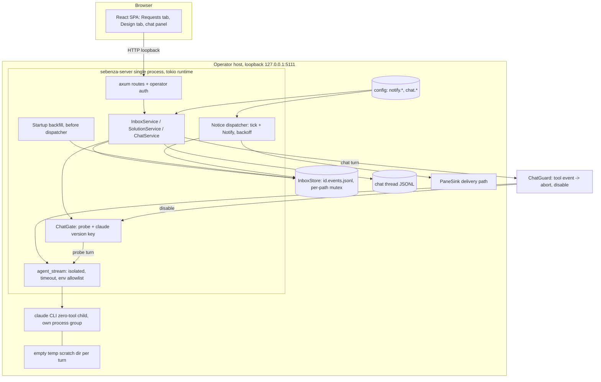

# Technical Architecture — Sebenza Polishing

Back to [design.md](./design.md).

## Narrative
No new crates or processes; all in the existing tokio runtime on loopback ([tech stack](../../tech-stack.md)).

- **Startup:** backfill runs before the HTTP listener binds (`append_event_once`, crash-safe; ~1 s per 10k events, logged progress). Then dispatcher and probe start.
- **Dispatcher:** one task; tick + `Notify` wake; backoff `min(base·2^n, 15 min)` folded from attempt events. At startup it rebuilds pending notices from the log and resumes. Each send is preceded by `notice_attempt{started}`; an interrupted attempt is retried (at least once), and the key `request_id:dismissal` in the notice text lets the agent ignore a duplicate. `PaneSink` is unchanged.
- **Chat turn:** provider pinned to `claude` at the absolute path resolved by the probe; system-agent `ENV_ALLOWLIST` (real HOME / `CLAUDE_CONFIG_DIR` / `ANTHROPIC_*` for auth, no `SEBENZA_*`); fresh tempdir removed on exit, timeout and kill; one turn per handover, `chat.max_concurrent_turns` global.
- **`ChatGate`:** `claude --version` cached 60 s; a change re-probes. In-flight turns finish under the guard; new turns get 503 while probing.
- **Observability:** `tracing` fields for pending-notice count, attempts, probe result, guard trips, backfill count.

## Diagram

| Config key | Default |
|---|---|
| `notify.max_attempts` / `base_delay_secs` / `poll_secs` | 6 / 5 / 30 |
| `chat.max_handover_tokens` / `max_transcript_tokens` | 60000 / 40000 (bytes/4 estimate) |
| `chat.turn_timeout_secs` / `max_concurrent_turns` | 120 / 2 |

## Decisions
1. Zero-tool argv: `allowed: []`, full built-in `disallowed` list, `strict_mcp: true`, no `--mcp-config`, `--settings` with `disableAllHooks`, non-permissive `permission_mode`, no resume, plus a new optional `ToolPolicy` field for `--tools ""` that defaults to `None`, so other callers are unchanged.
2. Probe passes only if stream-json `init.tools` is empty and no `tool_use` event appears; it is the sole writer of `enabled=true`.
3. `chat.enabled` is runtime state only; no config value can turn chat on.
4. Config lives in `NotifyConfig`/`ChatConfig` in `crates/common/src/domain/config.rs` with serde defaults.
5. Adversarial 60×3 harness runs in `cargo test` on replay; the live run (`SEBENZA_LIVE_ADVERSARIAL=1`) is the proposed AC-07b release gate, pending operator answer (design OQ 8).

## Risks
- Deny-by-list misses new built-ins; mitigated by `--tools ""`, the probe and the guard (flag needs verification).
- `GET /requests` cost grows with history; no compaction is allowed.
- A crash mid-send can deliver a notice twice; the embedded key makes the duplicate recognisable.
- The probe costs a model call per start/upgrade; an unauthenticated CLI fails the probe, so chat stays off (status shown).
- A slow append holds the per-item mutex; needs a timeout test.
