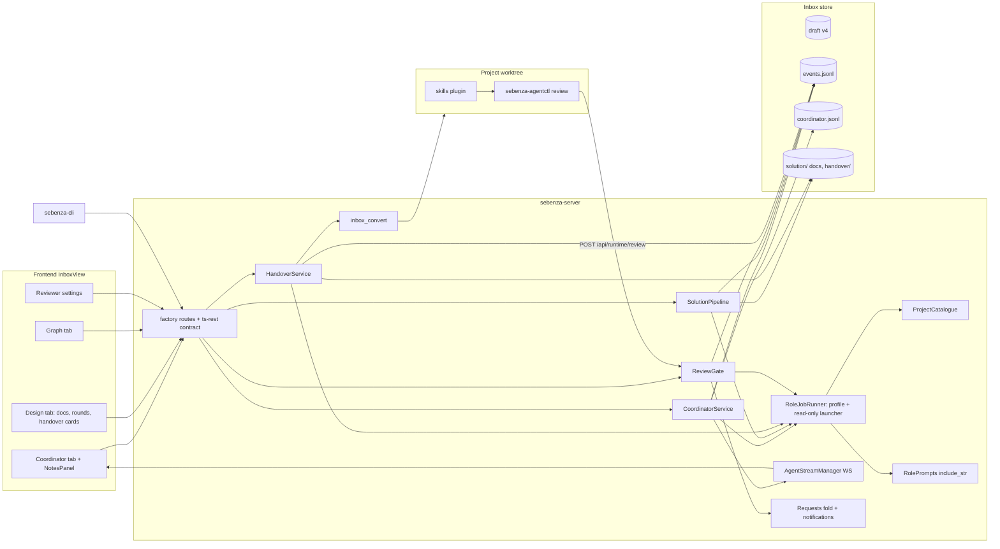

# Application Architecture — Sebenza Software Factory

Part of [design.md](./design.md). Honours BR-01..BR-15.

## Narrative
The factory is a set of thin services inside `sebenza-server`, layered on the existing inbox store and system-agent scheduler.

- **Role jobs.** The system agent is generalised from triage/draft/convert jobs to *role jobs*: an embedded prompt, an output schema, an agent profile and a read-only launcher. Roles: coordinator, analyst, architect, reviewer, handover-drafter, project-reviewer, code-reviewer.
- **Writes.** Roles never write files. They return validated JSON, and the daemon applies it with hash checks and events.
- **Ownership.** `ReviewGate` alone owns round counting and reviewer independence, for both levels.
- **Approvals.** Approval routes refuse non-operator callers (BR-01), and convert for `kind: solution` re-checks approval itself.
- **Project level.** The migrated `skills/` plugin drives the ordering. `sebenza-agentctl review` calls the daemon, so round 4 is refused by code, not by prompt; only the start of implementation is skill-enforced.
- **Prompts.** Role prompts are compiled in from `skills/agents/*.md` with `include_str!`.

## Diagram

## Components
| Component | Responsibility | Boundary |
|---|---|---|
| `CoordinatorService` | Per-turn resumed chat run; streams on the item agent WebSocket; persists `<id>.coordinator.jsonl`; applies proposed note upserts (`NoteUpserted`, hash-checked); turns a proposed problem resolution into a `Proposal` on that problem's request; posts the review report (transcript + existing Overall-thread `Comment` event) when the pipeline reaches `agreed` or `escalated` | Cannot start design, resolve or approve. Switching agent starts a fresh session seeded with a transcript digest |
| `SolutionPipeline` | Phase machine: analyst → architect → `ReviewGate` round → revise; writes `solution-design.md`, `solution-architecture.md` | Started only by the operator; unregistered project names become problems |
| `ReviewGate` | Sole writer of `ReviewRoundRecorded`; counts rounds per (item, level, cycle, track); 409 `round_limit` on round 4; independence check on save and at run; one request per problem on escalation | Shared by solution, project-design and code levels |
| `RoleJobRunner` | Role → profile {agent, model}; read-only launch per agent; output-schema validation; per-item FIFO, global `maxConcurrent` | Reuses `isolation.rs`, `output.rs`; `SystemAgentKind` grows from Claude-only to Claude, Codex, Grok, each role/CLI pair enabled only by the conformance table in [technical-architecture.md](./technical-architecture.md) |
| `ProjectCatalogue` | Registered projects (name, path, `product.md` summary) for roles | No filesystem access to other repos |
| `HandoverService` | Drafts per-project instructions; records approve/defer bound to instruction hash; gates convert; writes `solution-handover.md`; every gated action (here and in the pipeline) posts an attributed Overall-thread audit comment | Operator-only; a document edit after `DesignApproved` voids it |
| `FactoryConfig` | `factory:` block in `sebenza.yaml` (`solution{coordinator, designer, reviewer}`, `project{reviewer}`) + per-item overrides; `MAX_ROUNDS = 3` | In `common`; a worktree resolves overrides through its origin item |
| `inbox_convert` (extended) | Takes a `solution_handover` input for `kind: solution`; legacy path for `kind: note` only | One target per approval |
| Requests fold (extended) | Folds `ProblemRaised` as a request with `origin: solution_problem`; `RequestOpened` gains `origin` (worktree, approval, verification); a confirmed solution-problem resolution goes to the coordinator session, not a pane, and resolves the problem | Existing propose → confirm hash-binding reused |
| `sebenza-agentctl review` | Starts a review job, polls it, prints verdict + findings JSON; non-zero exit on `round_limit` / `not_independent` | Same token and conversion link check as `request` |
| `skills/` plugin | Ordering, review calls, approval checks (`inbox.py approval`), reopening tasks to `doing` from code-review findings, raising the final-verification request; local round record flagged not independent when unlinked. New role agents: `solution-coordinator`, `system-analyst`, `solutions-architect` (design + handover modes), `solution-reviewer`, `project-reviewer` (design + code levels) | Source of truth for role prompts. Implementation refusal is skill-enforced (the daemon cannot stop a shell agent coding) |
| Frontend | Coordinator / Design / Graph tabs; chat reuses `WorktreeConversationPanel` and its reducers; "round n of 3" badge; problem list; handover cards; reviewer settings | Every route in the ts-rest contract and `api.ts` |

## Interfaces
All routes need the inbox bearer token. **Operator-only** routes also need the operator credential (see [security-architecture.md](./security-architecture.md)).

| Method | Path | Purpose | Auth | CLI parity |
|---|---|---|---|---|
| POST | `/api/inbox` (existing, `kind` added) | Create a note or solution item | token | `sebenza-cli inbox new --kind solution` |
| GET | `/api/inbox/{id}/solution` | Folded state: phase, round n/3, problems, approvals, handovers, doc hashes | token | `inbox solution show` |
| POST | `/api/inbox/{id}/coordinator/turn` | Operator message → run, streamed on `/agent/stream` | operator | `inbox coordinator say` |
| GET | `/api/inbox/{id}/coordinator/transcript` | Persisted transcript | token | `inbox coordinator log` |
| GET/PUT | `/api/factory/config` | Global profiles; 422 `not_independent` | operator (PUT) | `sebenza-cli factory get\|set` |
| PUT | `/api/inbox/{id}/factory/agents` | Per-item coordinator, designer and solution/project reviewer profiles; 422 `not_independent` | operator | `inbox factory set` |
| GET | `/api/factory/agents` | Installed agents for pickers | token | `factory agents` |
| POST | `/api/inbox/{id}/solution/start-design` | Run analyst, then architect, then review | operator | `inbox solution start` |
| POST | `/api/inbox/{id}/solution/review` | Next round, or `newCycle` after escalation | operator | `inbox solution review [--new-cycle]` |
| GET/PUT | `/api/inbox/{id}/solution/docs/{name}` | Read / hand-edit docs, hash-checked (409) | operator (PUT) | `inbox solution doc` |
| POST | `/api/inbox/{id}/solution/problems/{pid}/resolve` | Mark a problem resolved by hand (coordinator resolutions use the existing request confirm route) | operator | `inbox solution resolve` |
| POST | `/api/inbox/{id}/solution/approve-design` | Approve, bound to doc hashes | operator | `inbox solution approve` |
| POST | `/api/inbox/{id}/handover/draft` | Draft per-project instructions (the only drafter for solution items) | operator | `inbox handover draft` |
| PUT | `/api/inbox/{id}/handover/{project}` | Edit instruction, branch, base | operator | `inbox handover edit` |
| POST | `/api/inbox/{id}/handover/{project}/approve` | Approve (instruction hash) → convert one target | operator | `inbox handover approve` |
| POST | `/api/inbox/{id}/handover/{project}/defer` | Defer a project | operator | `inbox handover defer` |
| POST | `/api/inbox/{id}/convert` (existing) | Refused (409 `approval_required`) for `kind: solution` | token | `inbox convert` |
| POST | `/api/runtime/review` | Start a project reviewer job on a read-only snapshot of the worktree → job id; 409 `round_limit`, 422 `not_independent`; a job failed by restart or timeout consumes no round | control token + conversion link | `sebenza-agentctl review --level design\|code --track <id>` |
| GET | `/api/runtime/review/{job}` | Poll the review job: verdict, findings, round n/3 | control token | (polled by `agentctl review`) |

Role prompts (`skills/agents/`): coordinator → `solution-coordinator`; analyst → `system-analyst`; architect and handover drafter → `solutions-architect`; solution reviewer → `solution-reviewer`; project and code reviewer → `project-reviewer`.

Role output envelope: `{role, schema_version, documents?, note_proposals?, problem_resolutions?, problems?, verdict?, report?}`, validated by the daemon. Event shapes: [data-architecture.md](./data-architecture.md).

## Decisions
- Role jobs extend the system-agent runner rather than adding a second runtime. Chat is a per-turn resumed run.
- `ReviewGate` is the single authority for rounds and independence at all three review levels.
- Approvals are operator-only routes, never agent tools. Convert re-checks approval (`assert_approved`).
- Prompts are embedded from `skills/agents/*.md` at build time. The daemon never reads `skills/` at runtime.
- The project review is an async daemon job polled by `agentctl`, so a long review never rides one HTTP request.

## Risks
- Seven roles on three CLIs with different sandbox semantics. A Codex or Grok enforcement gap breaks the read-only guarantee.
- `/api/runtime/review` runs a model inside a worktree, which is a larger prompt-injection surface than the scratch-dir roles.
- Concurrent writers (a hand-edit during a role job, a double-click on approve) need a per-item solution lock and idempotent approvals.
- Transcript-digest seeding on an agent switch loses fidelity, so coordinator behaviour differs by agent.
- The operator credential must not break existing UI and CLI flows that use the shared token.
