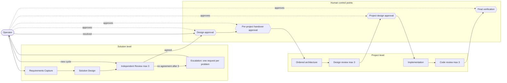

# Business Architecture — Sebenza Software Factory

Part of [design.md](./design.md).

## Narrative
Sebenza gains a governed, two-level delivery process: **Solution** (inbox) and **Project** (worktree). It adds one capability, *governed design-to-delivery*, and extends Requirements Capture, Design Review, Work Orchestration and Quality Assurance.

The operator is the sole accountable approver. Coordinator, analyst, architect and reviewer advise; none authorises implementation. The value stream:

```
brief → requirements → solution design → independent review
      → human approval → per-project handover → ordered project architecture
      → review → project design approval → implementation → code review
      → final verification
```

The control points are the value:
- Every handoff into implementation carries a human approval bound to the exact content approved.
- Reviews are independent of design and capped at 3 rounds.
- Every unresolved problem is its own trackable request.

Measures: approvals bound to content, share of independent reviews, rounds used per level, problems closed, and brief-to-approved-design lead time. Existing notes, graph, direct convert and requests keep working. The skills move to `skills/` as the single source of truth.

## Diagram


## Business Rules
| ID | Rule |
|---|---|
| BR-01 | Only the operator starts design, starts a review cycle, approves a design, approves or defers each project handover, approves a project design and signs off final verification. Role agents may only propose — note changes (applied, badged `coordinator`), problem resolutions and a "start" suggestion — and a proposal never triggers a gated action. |
| BR-02 | A design approval is bound to the design documents' hashes, a handover approval to its instruction hash; any later edit voids it. |
| BR-03 | A solution item creates no worktree until the solution design and that project's handover are approved; a project may be deferred. A worktree starts no implementation until the operator approves its project design. |
| BR-04 | The solution architecture names every registered project that must change; an unregistered name is a review problem. |
| BR-05 | Solution review runs at most 3 rounds, shown as "round n of 3" and enforced by the daemon; round 4 is refused. |
| BR-06 | No agreement after round 3 → escalate; each unresolved problem becomes its own inbox request. |
| BR-07 | A problem is resolved via the coordinator or by editing documents. With all resolved, the operator approves or explicitly starts a new review cycle; rounds reset only on that action. |
| BR-08 | Reviewer independence: its agent differs from the designer's, or — same agent — both models are explicitly set, differ, and the reviewer's model is at least as capable as the designer's. A lightweight model (e.g. Haiku) never reviews. Enforced on save and at run, at both levels, globally and per item (operator decision 2026-11-11). |
| BR-09 | Project design review is capped at 3 rounds and round 4 is refused; no agreement after round 3 goes to the project design approval with the open findings (Open Question 2). An unlinked worktree's in-session review is flagged "not independent". |
| BR-10 | Project architecture order: Business; then Application ∥ Data (with business doc + handover brief); then the final stage — Technical ∥ Security, then Test, which is derived from them. |
| BR-11 | Code review checks the code style guides, may send named tasks back to `doing`, ≤3 rounds; after acceptance or round 3 the operator verifies via an inbox request carrying any open findings. |
| BR-12 | Role agents reach the human only through inbox requests and Projects-screen notifications. |
| BR-13 | Legacy items keep notes, graph (incl. `%% sebenza:layout`), requests and comments; direct convert remains for `kind: note` only. |
| BR-14 | The plugin moves intact into `skills/` with provenance (source repo, commit, paths) and post-move changes recorded. |
| BR-15 | Reviewer agent/model is stored and configurable globally and per item, at both levels. |

## Decisions
- Operator-only approval gates bound to hashes keep accountability human and stop stale approvals (BR-01, BR-02).
- Round limits are fixed at 3 and enforced by the daemon, not by prompt wording.
- One request per escalated problem, never a bundle.
- Reviewer independence is a hard rule, not advice.
- Direct convert survives only for `kind: note`, so solution items cannot bypass the gates.

## Risks
- Approval fatigue tempts rubber-stamping; track time-to-approved-design.
- Independence blocks operators with one agent and one model.
- Grok read-only enforcement is unverified (Technical/Security).
- "Operator-only" relies on the security control for the shared token (T-01).
- Two copies of the skills until the sibling worktree removes the originals: drift risk.
