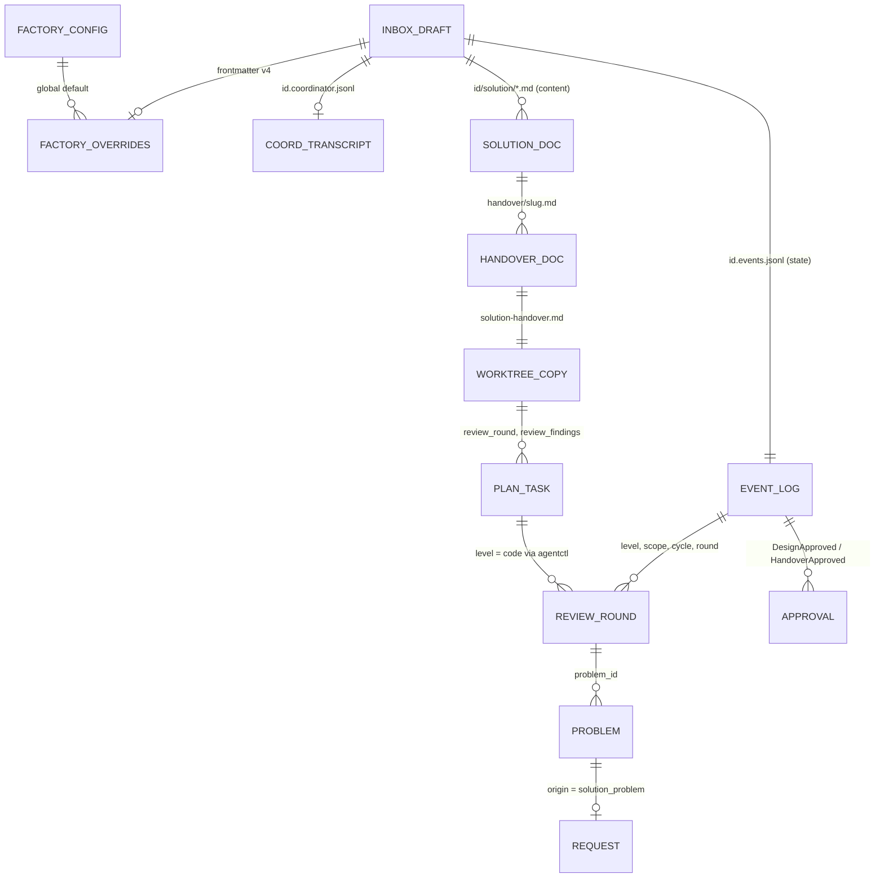

# Data Architecture — Sebenza Software Factory

Part of [design.md](./design.md).

## Narrative
- **Root record.** The inbox draft stays the root. Draft schema **v4** adds `kind` (note | solution) and optional `factory` agent-profile overrides. It is stamped only on solution items or items with overrides, so legacy notes stay v3 and old binaries can still read them.
- **State.** All factory state is **event-sourced** into the existing `<id>.events.jsonl`. The new kinds are additive, and old binaries skip them through `Unknown`. Events never hold design-document bodies; short problem text may be redacted with the existing `Redacted` event.
- **Content.** Content lives in files: `<id>.coordinator.jsonl` (the transcript) and `<id>/solution/` (design documents, `handover/<slug>.md`). The daemon is the only writer.
- **Approvals.** An approval binds to a SHA-256 of the content. It is valid only while the current hash equals the approved hash.
- **Worktree copies.** Each worktree gets a hash-stamped copy of its handover, plus an additive `solution` block in `inbox-notes.json`.
- **Review rounds.** Project-level rounds are recorded on the origin item. Code-review send-back fields live in `plan.json`, which only the skill writes.
- **Scanning.** Inbox content is untrusted. The existing secret/PHI scan runs on every new write path.

## Diagram

## Entities
| Entity | Source of truth / writer | Storage | Key fields |
|---|---|---|---|
| Draft frontmatter v4 | Draft file (Editor / Job ownership unchanged) | `~/.ai/sebenza/inbox/<ULID>.md`, 0600 | `kind` (absent = note); `factory{coordinator, designer, reviewer{solution, project}}`, each {agent, model?}; worktrees resolve it via their origin item |
| Notes | Body markers (unchanged codec) | same | SHA-1 per note and list |
| NoteUpserted | Daemon | event | note_id, author (operator, coordinator), note hash; the `coordinator` badge shows while the latest event's hash matches the note |
| CoordinatorTurn | Daemon | event | turn_id, agent, model, session_id, transcript offset — no text |
| SolutionPhaseChanged | Daemon | event | phase; transitions validated against the fold |
| ReviewCycleStarted | Operator only | event | level, scope, cycle — the only thing that resets rounds |
| ReviewRoundRecorded | Daemon (`ReviewGate`) | event | level (solution, project_design, code), scope, cycle, round 1..3, verdict, reviewer profile, doc hashes, problem_ids[]; unique on (level, scope, cycle, round) |
| DesignApproved | Operator only | event | {doc → SHA-256}, credential class; idempotent on (item, set of doc hashes) |
| HandoverDrafted / Approved / Deferred | Daemon / operator / operator | event | project, instruction_hash (SHA-256), design hash, branch, base; Approved idempotent on (item, project, instruction_hash); `converted` folds from frontmatter `conversions[]` |
| ProblemRaised | Daemon (`ReviewGate`) | event | request_id, problem_id, round ref, title, detail (authoritative problem text) — a new kind, so old binaries skip it rather than mis-fold a worktree-less request; resolved through the existing Proposal / ResolutionConfirmed / Resolved events |
| Request origin | `RequestOpened` (extended) | event | optional `origin` (worktree default, approval, verification); always has a worktree |
| SolutionState | Derived fold, never stored | — | phase, round, cycle, per-problem and per-handover status |
| Coordinator transcript | Daemon | `<id>.coordinator.jsonl`, 0600, append-only | agent-neutral turns |
| Solution documents | File; roles via daemon, or operator by hand | `<id>/solution/`, 0700/0600, temp+rename | expected-hash on every write; "Affected projects" table |
| Handover document | File | `<id>/solution/handover/<slug>.md` | slug = registered project name |
| Worktree handover copy | Copy at approval | `.ai/sebenza/solution-handover.md`, git-excluded | stamped instruction_hash |
| `inbox-notes.json` | convert | worktree | stays v1; optional `solution{project, design_hash, handover_hash}` |
| `plan.json` task fields | Skill only (`sebenza-review` reopens tasks and raises the verification request) | worktree | optional `review_round` (1..3), `review_findings[]` {id, text ≤500, status}, ≤20 per task |
| `metadata.json` approval | Skill mirror of the `[approval]` answer | track dir | `design_approved{at, request_id, design_hash}`; inbox event authoritative |
| FactoryConfig | `~/.ai/sebenza.yaml` `factory:` | 0600 | `solution{coordinator, designer, reviewer}`, `project{reviewer}`; limits are constants |

Scope key for project rounds = `<project path>@<branch>/<track_id>`, persisted in the event and never inferred.

## Decisions
- Solution state is event-sourced in the existing log. There is no new state store, and old binaries skip the new kinds.
- v4 is stamped lazily, so migration is a no-op for legacy notes. There is no backfill.
- Approval validity is derived from SHA-256 hashes. SHA-1 stays for note concurrency only.
- Rounds are appended under the per-item mutex, with a unique key. Project rounds are logged on the origin item for one audit trail.
- Role agents never write. Worktree copies are hash-stamped derivatives, and the inbox copy is the source of truth.

## Risks
- Old binaries do not see solution problems at all (`ProblemRaised` is `Unknown` to them). Upgrade server and CLI together.
- A hand edit can race a role write. Expected-hash is mandatory on every document write.
- The event log and transcript grow without compaction.
- Worktree copies go stale after an inbox edit. The approval is voided and the UI must show the copy as stale.
- A re-created worktree must not reset its round count. The scope key is persisted.

## Classification
| Data | Class | Handling |
|---|---|---|
| Notes, brief, requirements | Internal; may hold secrets or PHI | Existing scan on every ingest, including coordinator turns, proposals and documents |
| Coordinator transcript | Internal, possibly sensitive | 0600; never copied to worktrees |
| Solution design, architecture, handover | Internal confidential | Copied to git-excluded worktree paths |
| Events (ids, hashes, verdicts, problems) | Internal | Problem text scanned |
| Approvals and hashes | Integrity-critical | Hash binding makes tampering evident |
| `plan.json` findings | Internal | Short text, capped |
| Project catalogue | Internal | Names, paths, `product.md` summary only |
| FactoryConfig | Internal | Agent and model names only |
| Provider tokens, control token | Secret | Never in factory data or transcripts |

Retention: sidecars, transcript and `solution/` live and die with the draft.
