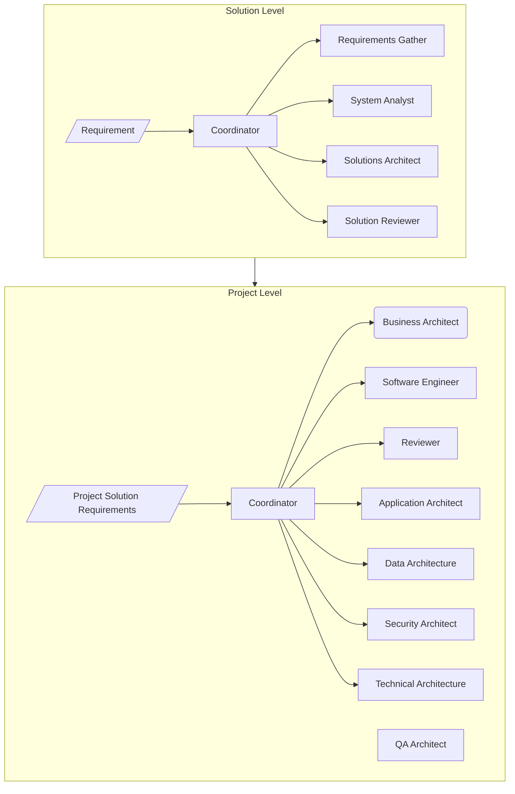
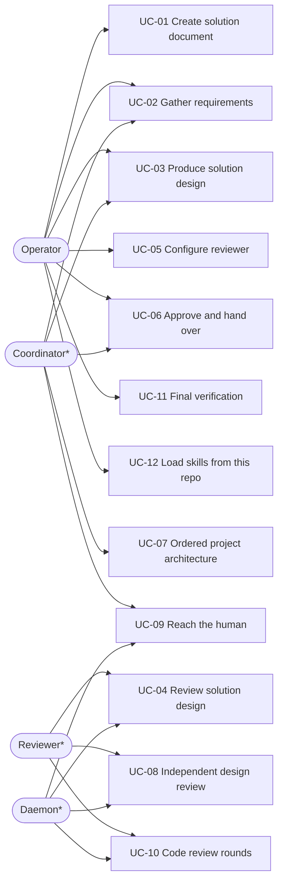
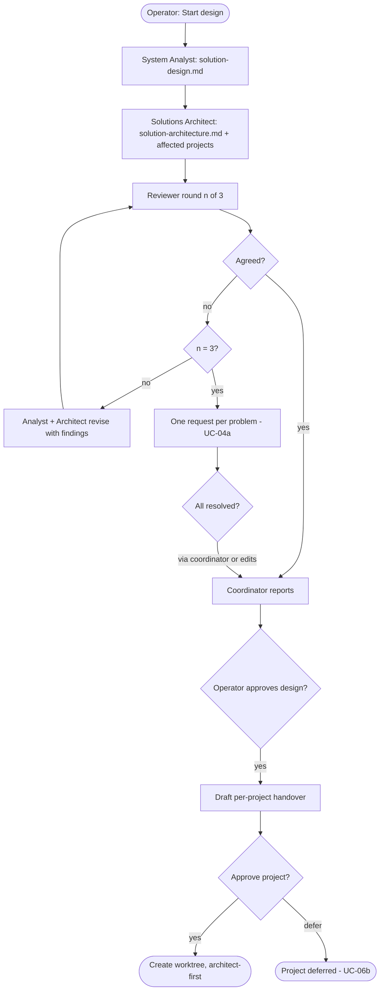
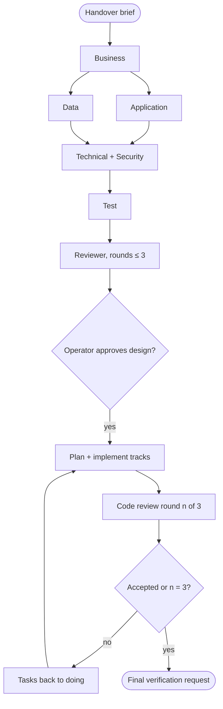
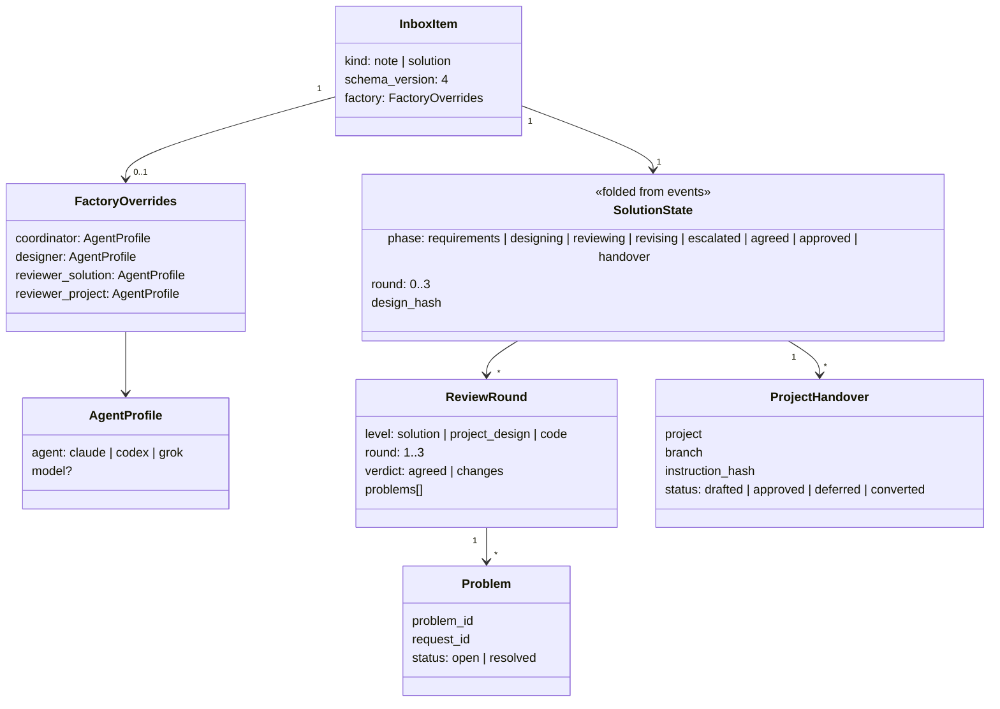
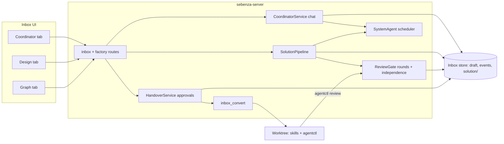

# Design: Sebenza Software Factory

## Overview
Sebenza becomes a two-phase factory. **Solution level** (inbox): a *solution document* opens on Coordinator / Design / Graph tabs. The operator chats with a coordinator (Claude, Codex or Grok) to turn a brief into notes, constraints and acceptance criteria. A System Analyst and Solutions Architect then produce a design naming the affected Sebenza projects. An independently configured Solution Reviewer checks it in ≤3 rounds, escalating each unresolved problem as its own request. **Project level** (worktree): ordered architects, an independent reviewer and ≤3 code-review rounds. Every implementation handoff needs explicit human approval. The Sebenza skills move here, under `skills/`.

The operator's intended structure, carried verbatim from the inbox note:

## Actors
- **Operator** — briefs, chats, edits, resolves problems, approves.
- **Coordinator\*** — inbox chat agent; in a worktree, the main agent running the skills.
- **System Analyst\***, **Solutions Architect\*** — designers; read-only.
- **Reviewer\*** — solution and project reviewer, on its own agent and model.
- **Project architects\*** — business, application, data, technical, security, test.
- **Daemon\*** — runs roles, counts rounds, gates approvals, notifies.

(\* system actor)

## Use Cases
- **UC-01 Create solution document** (S1) — opens on Coordinator / Design / Graph. **UC-01a** A legacy item opens on the same tabs, its notes in the left panel.
- **UC-02 Gather requirements** (S2) — pick an agent, chat; the coordinator writes general, constraints and acceptance-criteria notes. **UC-02a** Agent not installed → disabled in picker. **UC-02b** Stale note hash → conflict, nothing lost.
- **UC-03 Produce solution design** (S3) — on the operator's explicit start, analyst then architect write the design; the architecture names affected registered projects. **UC-03a** An unregistered project is named → review problem.
- **UC-04 Review solution design** (S4) — reviewer rounds 1–3, revising between. **UC-04a** No agreement after round 3 → one inbox request per problem. **UC-04b** Resolve a problem with the coordinator. **UC-04c** Resolve it by editing the document.
- **UC-05 Configure reviewer** (S5, P2) — set the reviewer agent/model for solution and project level, globally and per item. **UC-05a** Same agent and model as the designer → refused.
- **UC-06 Approve and hand over** (S6) — operator approves the design; coordinator and architect draft per-project instructions; operator edits and approves each project, creating its worktree. **UC-06a** A document or instruction changed after approval → approval void. **UC-06b** A project is deferred.
- **UC-07 Ordered project architecture** (P1) — business; then application + data with the handover brief; then the final stage: technical and security, then test.
- **UC-08 Independent design review** (P2) — the daemon runs the project reviewer on its agent/model, ≤3 rounds. **UC-08a** Unlinked worktree → in-session reviewer, flagged not independent.
- **UC-09 Reach the human** (P3) — requests on the item and Projects-screen notifications; implementation waits for an approved design.
- **UC-10 Code review rounds** (P4) — reviewer reviews against the code style guides and sends tasks back to `doing`, ≤3 rounds. **UC-10a** Round 3 still failing → stop, findings carried to verification.
- **UC-11 Final verification** (P4) — the operator verifies via an inbox request.
- **UC-12 Load skills from this repo** (M) — `skills/` is the plugin, installable from this repository.

## Activity
Solution pipeline (UC-03, UC-04, UC-06):

Project worktree (UC-07, UC-08, UC-10):

## Class

## Component

## Architecture
| Domain | Document | Scope |
|---|---|---|
| Business | [business-architecture.md](./business-architecture.md) | In scope — capabilities, BR-01..BR-15 |
| Application | [application-architecture.md](./application-architecture.md) | In scope — services, routes, CLI parity |
| Data | [data-architecture.md](./data-architecture.md) | In scope — draft v4, events, documents |
| Technical | [technical-architecture.md](./technical-architecture.md) | In scope — role runner per CLI, packaging, CI |
| Security | [security-architecture.md](./security-architecture.md) | In scope — operator token, read-only roles, FT-01..FT-15 |

## Acceptance Criteria
One or more per numbered behaviour of the system instruction; each is proved by a `TS-nn` in [test-plan.md](./test-plan.md).

| AC | Behaviour | Criterion |
|---|---|---|
| AC-S1.1 | S1 | "New solution" creates an item with `kind: solution`; opening it shows exactly the tabs Coordinator, Design, Graph |
| AC-S1.2 | S1 | A legacy (v3) item opens on the same tabs, lists its notes in the Coordinator left panel, and its graph and requests behave as before |
| AC-S2.1 | S2 | The coordinator agent picker offers Claude, Codex and Grok; an uninstalled agent is disabled; Grok shows a "read-only unverified" badge, and choosing Grok as reviewer is refused with a clear reason |
| AC-S2.2 | S2 | An operator message produces a streamed coordinator reply persisted in the transcript, which survives reload |
| AC-S2.3 | S2 | A coordinator note proposal of type general, constraints or acceptance_criteria appears in the left panel badged `coordinator`; a stale hash yields 409 and no data loss |
| AC-S3.1 | S3 | Design starts only on the operator start action; a coordinator "start" proposal alone starts nothing |
| AC-S3.2 | S3 | Analyst then architect write `solution-design.md` and `solution-architecture.md`, shown in the Design tab |
| AC-S3.3 | S3 | The architecture's affected-projects table lists only registered projects; an unregistered name becomes a review problem |
| AC-S4.1 | S4 | Review rounds are shown as "round n of 3"; revisions run between rounds; a 4th round is refused (409 `round_limit`) |
| AC-S4.2 | S4 | No agreement after round 3 opens exactly one inbox request per unresolved problem |
| AC-S4.3 | S4 | A problem resolved through the coordinator (its proposed resolution confirmed by the operator) or by a hand edit plus "resolve" closes that request only |
| AC-S5.1 | S5, P2 | Reviewer agent/model is saved globally and per item at both levels and is used by the next review job |
| AC-S5.2 | S5, P2 | A reviewer with the designer's agent and the same, unset, less capable or lightweight model is refused on save and at run (422 `not_independent`, with the reason) |
| AC-S6.1 | S6 | After review the coordinator's report is persisted in the transcript and as an item comment, and the design awaits the operator's approval; nothing converts before it |
| AC-S6.2 | S6 | Approval drafts one instruction per affected project; the operator may edit it; each project is approved or deferred separately and only an approved one creates a worktree, receiving the approved bytes as `solution-handover.md` |
| AC-S6.3 | S6 | Editing a design document or instruction after approval voids it; convert of a solution item without approvals is refused (409 `approval_required`) |
| AC-S6.4 | S6 | Every operator route (security-architecture.md) rejects the shared control token (403 `operator_required`); approvals are idempotent and each writes an audit comment |
| AC-P1.1 | P1 | The architect skill runs business first, then application and data with the business doc and handover brief, then technical and security, then test |
| AC-P2.1 | P2 | `agentctl review --level design` runs the configured project reviewer read-only on a snapshot and records a round; a 4th design round is refused; an unlinked worktree's review is recorded locally and flagged not independent |
| AC-P3.1 | P3 | Project-level requests appear on the origin item and raise a Projects-screen notification; the skills refuse to implement until the `[approval]` request is answered |
| AC-P4.1 | P4 | Code-review findings set the named tasks back to `doing`; rounds are capped at 3 and the 4th is refused |
| AC-P4.2 | P4 | After acceptance or round 3 a final-verification request is raised carrying any open findings |
| AC-M.0 | Migration | The move ships first, changes no skill behaviour, and a check validates the repo-root marketplace `sebenza` and plugin `sebenza` (stable names) |
| AC-M.1 | Migration | `skills/` contains the seven skills, agents, shared, scripts and hooks unchanged in structure; the repo marketplace installs it; its python tests pass; `MIGRATION.md` records source and post-move changes |
| AC-M.2 | Migration | Role prompts embedded in the server come from `skills/agents/*.md` |

## Impact Analysis
- `common`: draft v4, new events, solution fold, `FactoryConfig`.
- `system_agent`: role jobs on Claude / Codex / Grok profiles.
- Routes, contract, CLI: coordinator, solution, review, approval, operator login.
- `inbox_convert`: solution items convert only through approved handovers.
- Requests gain `origin`; `agentctl` gains `review`.
- Frontend: three tabs, coordinator chat, Design tab, reviewer settings.
- `skills/`: migrated plugin, marketplace, extended skills, `MIGRATION.md`.

## Open Questions for Refinement
1. ~~Override of reviewer independence~~ — resolved 2026-11-11: no override; same agent needs a different, at-least-as-capable, non-lightweight model.
2. Should unresolved project-level design or code findings after round 3 become one request each, like the solution level, or ride the verification request?
3. Should the design approval hash also cover the notes and acceptance criteria that fed it?
4. Does Claude's permission syntax confine `Read` to the scratch dir, or must the daemon stage a copy?
5. Which grok `--sandbox` profiles exist, and can grok pass the write/network conformance test?
6. Is 600 s enough for large code reviews, or should the timeout scale with the diff?
7. ~~Close the shared-token gap now~~ — resolved 2026-11-11: deferred to a follow-up item; residual documented as a known limitation.
8. Should events and transcripts be compacted, and should dropping an item hard-delete its `solution/` folder?
9. Can `claude plugin marketplace add` reach this repo for non-owners, or must `install.sh` add a local clone?
10. When are the gts-agent-extensions originals removed, and who owns `skills/` changes until then?
