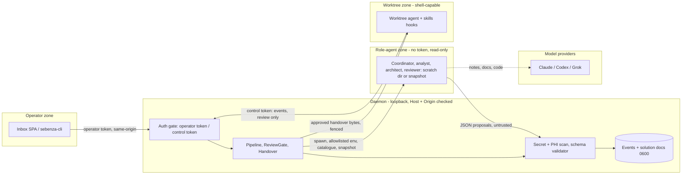

# Security Architecture — Sebenza Software Factory

Part of [design.md](./design.md). Extends the register in [SECURITY.md](../../SECURITY.md).

## Narrative
Agents and the operator share one OS user and, today, one control token:
- `GET /api/inbox/session` accepts a request with no `Origin`;
- `caller_marker` is an unauthenticated header, and worktree agents hold the same token (system_agent_20260930's T-01, not yet in the register; this track registers it as FT-01).

The factory adds human gates, and a gate is only meaningful if an agent cannot press it, so credentials are split by privilege:
- **Operator session token.** In memory, minted per daemon run. Issued to the SPA only when `Sec-Fetch-Site: same-origin` and the Origin/Host checks pass. Issued to `sebenza-cli` only through a login the operator confirms in the UI. Never placed in an agent env, pane or worktree file. It alone opens every operator route — coordinator turn; start-design; review / new cycle; document PUT; problem resolve; request confirm on solution problems; design approve; handover draft, edit, approve and defer; factory config and per-item agent PUTs — and the server derives the audit `caller` from it.
- **Role agents.** No token, scratch or read-only snapshot cwd, read-only tooling, schema-validated JSON out. Their output is a proposal, never an action.
- **Approvals.** SHA-256-bound and idempotent.

**Residual:** issuance rests on forgeable headers, so an unsandboxed same-uid agent *can* mint the token. For unsandboxed worktrees the gates are deterrence plus audit (each gated action posts an attributed item comment); only the lxc/Apple sandbox makes them enforcement.

## Diagram

## Decisions
- **Operator token.** It is the only credential accepted on operator routes. The shared control token gets 403 `operator_required` there, while legacy routes accept both. The CLI obtains the operator token by confirm-in-UI login, cached 0600 with a TTL.
- **Read-only role agents.** Claude runs in plan mode with an allowlist and `Read` deny rules for `~/.ai`, `~/.ssh` and credential directories. Codex runs with `--sandbox read-only`. Grok may run scratch-dir roles only (S2 requires it as a coordinator choice). It is shown as "read-only unverified" and needs an operator acknowledgement, and it is refused for the worktree reviewer until its conformance test passes.
- **Project reviewer.** It reads a daemon-built snapshot (`git ls-files --cached --others --exclude-standard`, so new untracked code is reviewed, excluding `.git`, `.env*`, keys, `.claude/`, `.codex/`, `.grok/`, `CLAUDE.md`, `AGENTS.md`) with project hooks disabled. Afterwards, any snapshot or live-tree change (`git status`, HEAD) voids the round and raises an alert.
- **Approvals.**
  - `DesignApproved` binds a SHA-256 of each document's stored bytes. `HandoverApproved` binds project, instruction hash and design hash.
  - Both are recomputed under the item lock, and the approved bytes are written verbatim.
  - Approvals are idempotent: design on `(item, doc-hash set)`, handover on `(item, project, instruction_hash)`.
- **Scanning.** The scan runs as warn-and-confirm on operator input, as reject or redact on all agent output, and again before every paste. All new views render through the existing DOMPurify plus mermaid-strict path (T-004).

## Risks
- Same-uid agents outside a sandbox can read the cached CLI token or forge headers, so the gates are deterrence and audit, not enforcement.
- Per-CLI read-only claims are only as strong as each CLI's flags. Codex `read-only` limits writes, not reads, so a Codex role can read `~/.ssh`; Claude `Read` confinement needs a conformance test.
- Coordinator-authored notes persist and can steer later agents (stored injection). This is mitigated only by a provenance badge.
- Notes and code go to third-party providers, and the scan misses secrets (T-005).
- The skills' python hooks run as the user, so a tampered plugin is code execution.

## Threat Model
| ID | STRIDE | Threat | Severity | Mitigation |
|---|---|---|---|---|
| FT-01 | E | Worktree agent calls any operator route with the shared token, or forges headers to mint the operator token | Critical | Operator token only on every operator route; 403 `operator_required`; token never in agent env; residual High for unsandboxed worktrees (audit comment on every gated action); register as Open at close-out |
| FT-02 | S | Self-declared caller header mislabels an agent as operator | Medium | Caller derived from credential class; header ignored on gated routes |
| FT-03 | E | Prompt-injected role agent triggers a gated action or writes files | High | No token or shell; JSON-only output; proposals inert |
| FT-04 | E | Read-only enforcement fails for a CLI; reviewer mutates the worktree | High | Per-CLI profile + conformance gate; snapshot; post-run change check voids round |
| FT-05 | E | Repo `.claude/`, hooks, `CLAUDE.md`, `AGENTS.md` steer or run inside the reviewer | High | Excluded from snapshot; project settings and hooks disabled |
| FT-06 | I | Role agent reads `~/.ai` or `~/.ssh` and leaks to provider or note | High | Claude `Read` deny rules; Codex: residual (reads unconstrained) unless sandboxed; 0600 tokens; output scanned for token patterns |
| FT-07 | T | Design or instruction edited between approval and use | High | SHA-256 binding recomputed under lock; edit voids; approved bytes written verbatim |
| FT-08 | R | Replayed or duplicated approval creates extra worktrees | Medium | Idempotency key; audit records credential class |
| FT-09 | T | Round count forged or reset to dodge the cap | Medium | Rounds folded server-side; 409 `round_limit`; reset only via operator `newCycle` |
| FT-10 | E | Coordinator note carries stored injection to worktree agents | Medium | `author: coordinator` badge; caps; notes fenced as data |
| FT-11 | I | PHI or secrets reach providers, documents or panes | High | Scan on input (warn), output (reject/redact), pre-paste |
| FT-12 | E | Plugin from this repo is tampered with; hooks run code | High | Explicit install; commit-pinned source; stdlib, loopback-only hooks; `skills/**` review |
| FT-13 | D | Turn or job floods exhaust CPU, spend or disk | Medium | Per-item FIFO, `maxConcurrent`, turn and size caps, timeouts, round caps |
| FT-14 | S | Stolen operator session token reused locally | Medium | 8 h TTL; rotated per daemon run; never in URLs or logs |
| FT-15 | T | XSS or mermaid injection via agent-authored documents or cards | High | Reuse DOMPurify + mermaid strict for every new view |

## Known Limitation
Operator decision (2026-11-11): accepted for now. Outside lxc or Apple sandboxes the operator gates only deter and leave an audit trail; every approval still writes its audit comment. This is stated in the user-facing docs (README) and a follow-up item tracks real enforcement.

## Compliance
No PHI by design: these documents describe software, and HIPAA is out of scope. The scans, the 0600 store and the log-redaction rules stay, because operators may paste sensitive text (T-005, T-007). Approvals and rounds are audit events carrying credential class, item, hash and time. The settings UI discloses that notes and code go to the selected model provider.
