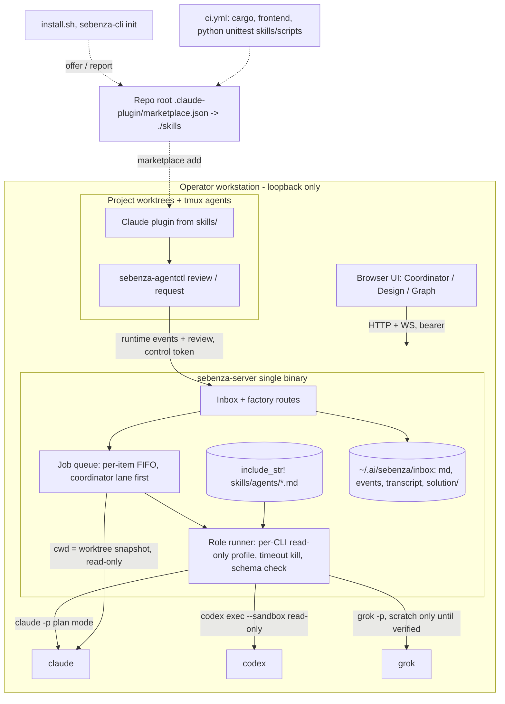

# Technical Architecture — Sebenza Software Factory

Part of [design.md](./design.md).

## Narrative
No new infrastructure is added. The factory remains one loopback daemon plus the CLI, local tmux worktree agents and vendor CLIs on PATH.

**Role jobs.** Role agents run as headless, read-only jobs on the existing system-agent runner, which is generalised from Claude-only to Claude, Codex and Grok. Each job gets:
- an empty per-item scratch directory and an allowlisted environment;
- its own process group, killed on timeout;
- a reply validated against a JSON schema.

**Lanes.** The two job classes share the global `maxConcurrent` pool. Coordinator turns are interactive and streamed, and they get a reserved slot. Design and review jobs are batch jobs with a longer timeout.

**Packaging.** Role prompts are embedded with `include_str!` from `skills/agents/*.md`, so the binary stays self-contained. `skills/` is the Claude plugin root, published through a repo-root marketplace manifest; `install.sh` offers it and `sebenza-cli init` reports it.

**Project reviews** go through `sebenza-agentctl review`. The daemon runs the reviewer CLI read-only on a daemon-built snapshot of the worktree (see [security-architecture.md](./security-architecture.md)), with project hooks and settings disabled, voids the round if a post-run `git status`/HEAD check shows any change, enforces the 3-round cap and records rounds as events. There is no new service, database or port.

## Diagram

## Read-only invocation per CLI
Flags were checked against local `--help`. The claude row is the launch shipping today.

| CLI | Role-job invocation | Status |
|---|---|---|
| claude | `claude -p --output-format stream-json --permission-mode plan --allowedTools Read,Grep,Glob --disallowedTools Bash,Edit,… --settings <deny Read of ~/.ai, ~/.ssh, credential dirs> [--model M]` | Shipping; enabled for all roles; `Read` confinement proved by conformance (Open Question 4) |
| codex | `codex exec --json --sandbox read-only --ephemeral --skip-git-repo-check [--model M] [--output-schema F] -C <dir>` | Flags confirmed; new args builder needed (today's `run_codex` ignores model, sandbox, timeout); enabled once its conformance test passes |
| grok | `grok -p <prompt> --output-format streaming-messages-json --permission-mode plan --disallowed-tools <write/shell> --max-turns N [--model M]` | Headless plan-mode and `--sandbox` profiles unverified; scratch-dir roles only, shown "read-only unverified" with an operator acknowledgement (S2); refused as project reviewer until verified |

**Conformance gate.** For each CLI, an opt-in test (skipped when the binary is absent) asks the agent to write a file and run a shell command, and passes only if neither takes effect. Each role/CLI pair is enabled only through a code table that records which profiles passed.

## NFRs and failure modes
| Concern | Behaviour |
|---|---|
| Coordinator turn | Streamed over the existing WS; `factory.chatTimeoutSecs` 180; `turnCap` 40 |
| Design / review job | `factory.jobTimeoutSecs` 600; whole process group killed. Triage / draft / convert keep `systemAgent.timeoutSecs` (120) |
| Concurrency | Shared `maxConcurrent` (default 2); one slot reserved for coordinator turns only when `maxConcurrent` ≥ 2; per-item FIFO |
| Cost | Design/review jobs ≤9 per solution cycle (3 × analyst, architect, reviewer), excluding chat turns, handover drafting and JSON repairs; per-job usage in events |
| Restart | State is an event fold; in-flight jobs (incl. `agentctl review` jobs) are marked `failed: daemon_restart`, consume no round and are retryable; `agentctl` reports the failure |
| Agent missing | Checked on save and at run; no job, no round consumed |
| Timeout / invalid JSON | One repair retry for JSON, then fail; nothing written to documents; round not consumed |
| Observability | Job start/finish/fail events with agent, model, CLI version and duration; truncated, secret-scanned stderr tail |
| Rollback | v4 is stamped lazily (solution items, overrides only); old binaries read but refuse to write v4 items |

## Packaging and CI
- **Plugin root.** `skills/` holds `.claude-plugin/plugin.json`, `skills/sebenza-*`, `agents/`, `shared/`, `scripts/` and `hooks/`. The root `.claude-plugin/marketplace.json` (`sebenza`, source `./skills`).
- **Install.** `install.sh --with-plugin` runs `claude plugin marketplace add` and `install sebenza@sebenza`, and is never silent. `sebenza-cli init` reports the plugin as present, missing or version-mismatched.
- **CI.** New `.github/workflows/ci.yml` runs `cargo test`, the frontend tests and build, and `python3 -m unittest discover -s skills/scripts`. The same commands are added to `workflow.md`.
- **Tests.** All tests use fake CLI shims with recorded fixtures. Real CLIs run only in the opt-in conformance tests.

## Decisions
- Reuse the system-agent runner rather than adding a new service.
- Enable each role/CLI pair only through a per-CLI profile table backed by a conformance test.
- Use two lanes with a reserved coordinator slot: 180 s for chat, 600 s for design and review.
- Embed role prompts with `include_str!`. Report a plugin/embedded version mismatch as a warning.
- Add `ci.yml`. Today's only workflow runs on release tags, and the migration adds about 2,000 lines of Python.

## Risks
- Codex `read-only` constrains model shell commands. Its patch tool or network access may not be constrained, so the conformance test is required.
- Grok's unverified enforcement limits which reviewers satisfy independence.
- Vendor output formats drift; parsers are covered by recorded-fixture tests.
- The reviewer snapshot copies tracked and untracked-unignored files: wide exposure, by necessity for code review.
- Cost can run away; mitigated by visible rounds and logged usage.
