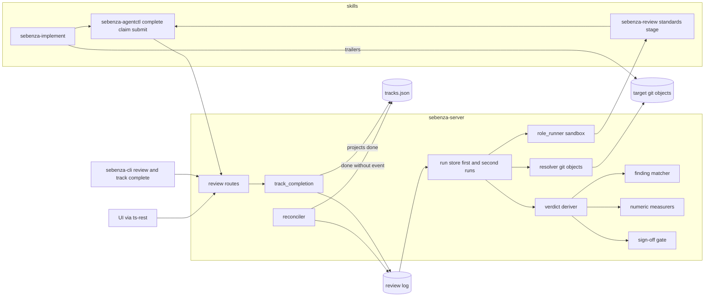

# Application Architecture — Standards review at track completion

Back to [design.md](./design.md).

## Narrative
The daemon owns completion. A skill calls `sebenza-agentctl complete` (control token); `services/track_completion.rs` is the only writer of `completed`. It appends one fsynced review-log event (status plus job key), then projects `status: "done"` to tracks.json (status and updated_at only, file lock, content-hash CAS). A reconciler appends the missing event when it finds `done` with no completion event, and re-enqueues jobs lacking the current key. `services/standards_review/` sits beside `project_review.rs`: resolver (git objects only, via `git.rs`), run store (leases, single-use tokens, attempts per run kind), a verdict deriver containing the finding matcher and numeric measurers, and the sign-off gate. It reuses `role_runner/` and `review_snapshot.rs`. The daemon schedules a `kind=second` run for subjective rules, with fresh context, manifest subset and hunks only, and reconciles agreement. The deriver takes the existing sebenza-review check results as required inputs; the standards stage is additive. Skills reach the daemon through `sebenza-agentctl`; if it is unreachable the stage reports `not-run`, never `clean`. Routes go in the ts-rest contract and mirror as `sebenza-cli review ...`, plus `sebenza-cli track complete`.

## Diagram

| Interface | Token | Contract |
|---|---|---|
| `sebenza-agentctl complete` / `POST /tracks/{id}/complete` | control | Log event then projection; idempotent on job key |
| `POST /tracks/{id}/plan/approve` | operator | Called by the UI or `sebenza-cli` when the operator approves sebenza-plan's `[approval]` request; hashes plan.json at the committed SHA, snapshots per-task boundary; later plan.json edit makes it stale until re-approved |
| `POST /review-runs/claim` (`kind=first\|second`) | run token (daemon-minted, single-use, in the agent's env; control token refused) | First: manifest, hunks, open prior findings. Second: manifest subset and hunks only, no first-run output |
| `POST /review-runs/{id}/submit` | run token | Matrix with `clean` span citation per pair; no code excerpts; free text redacted, PHI hit or scanner error rejects; 422 on missing pair or prior finding; daemon-measured breach overrides agent `clean`; carries no existing checks |
| `sebenza-agentctl review-checks` / `POST /api/review/tracks/{id}/existing-checks` | control | The four existing sebenza-review checks, reported from the track's worktree; the latest report re-derives the verdict; none reported is non-passing |
| (internal) second-run reconcile | n/a | Agree decides; disagree gives `needs-operator-decision`; unfinished second run keeps verdict non-passing |
| `POST /findings/{id}/decision` | operator | Resolves `needs-operator-decision` |
| `POST /tracks/{id}/signoff` | operator (control, run token: 403 `operator_required`) | Passing verdict, then CAS on head and merge-base in one log transaction; 409 `no_verdict`, `verdict_not_passing` (with reasons) or `stale_verdict` |

## Decisions
- Completion is daemon-only: log event first, tracks.json projection second (completed <-> done), reconciler repairs legacy `done` with a `source=reconciled` event under the same job key, so a repeat is a no-op.
- The control token cannot approve a plan; boundary snapshot is operator-token, daemon-side, hash-pinned.
- Verdict, finding status and measurements are daemon-only; the matcher (renames, rule id plus normalised-text hash, out-of-scope, rule-withdrawn at current merge-base) lives in the deriver; existing review checks are required inputs.
- Second run is a distinct run kind with its own token and fresh context; attempts counted per kind, three gives `review-failed`.
- Every route lands in `api-contract` and the CLI together; egress allowlist (model provider and run API only) is proposed, pending operator confirmation.

## Risks
- Log-first then projection can briefly disagree with tracks.json; CAS failure must retry, not drop the projection.
- Operator recovery from `review-failed` is undefined.
- `project_review.rs` overlap may tempt a merged job model; keep them separate.
- Measurers cover few languages; the second-run fallback doubles run cost.
- Hand-made commits lacking trailers, or a stale boundary after a plan edit, block sign-off.
