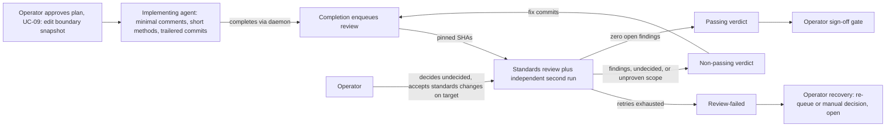

# Business Architecture — Standards review at track completion

Back to [design.md](./design.md).

## Narrative
Sebenza gains a trustworthy completion gate. The implementing agent completes a track through the daemon; completion only enqueues a standards review of the track's own changes, judged against the project's `.ai/sebenza/` standards at the merge-base. The operator approves the plan (snapshotting each task's edit boundary), decides undecided findings, owns recovery from review-failed, and signs off; no agent approves. Implementation also gains writing guidance: minimal comments, short extracted methods, new and changed code only. Unresolved or undecided findings prevent a passing verdict, and sign-off requires a passing verdict. Hand-made commits without Sebenza trailers make scope unproven. Subjective findings need two agreeing reviews. Standards edits made on a track must land on the target branch. No waivers this release. Value: project-owned standards applied identically at write and review time (see [product.md](../../product.md), [workflow.md](../../workflow.md)).

Success measures: share of completed tracks with a verdict, undecided-finding count, time to sign-off.

## Diagram

## Decisions
1. Daemon owns completion and verdict; sign-off needs a passing verdict, so no agent can self-certify.
2. Standards are project-owned `.ai/sebenza/` documents at merge-base; skills hard-code nothing, keeping writing and review consistent.
3. AC-06 proposed as conditional on the categories each project defines (operator confirmation pending); setup templates ship defaults so new projects have them.
4. Standards edits must land on the target branch, so a track cannot loosen its own bar.
5. No waivers this release; the operator resolves only disagreements, keeping the gate strict and simple.

## Risks
1. Existing projects lack standards rules until the operator approves the upgrade diff, so reviews there are informational only.
2. Trailer enforcement blocks hand-made commits, adding operator toil during rollout.
3. Double-run cost and agreeing-but-wrong reviewers; sign-off is the sole backstop.
4. Strict no-waiver gate may stall tracks on contested findings, increasing operator decision load.
5. Method-length measurement fails without a language parser, leaving that rule to subjective agreement.
