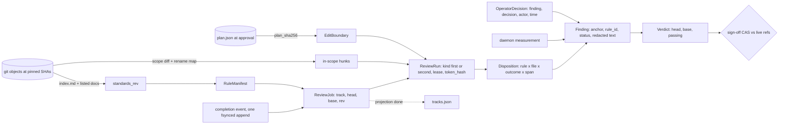

# Data Architecture — Standards review at track completion

Back to [design.md](./design.md).

## Narrative
The daemon owns review data; projects own their standards. Review state lives in a per-project fsynced append-only review log under `~/.ai/sebenza/` (the inbox `events.jsonl` pattern, see [technical-architecture.md](./technical-architecture.md)); state is a fold over it. One `track-completed` event carries status and job key, so completion is a single append. The daemon is the only writer of `completed` and projects it to `tracks.json` as `done` (completed <-> done); on disagreement the log wins and the reconciler repairs the file.

A job is keyed by (track, head SHA, base SHA, standards_rev). `standards_rev` is the SHA-256 of (path, blob SHA) pairs sorted by path for `index.md` and its listed documents at the merge-base, read from git objects. A listed-but-missing document contributes (path, "missing") and makes the job standards-unavailable. Each job records its `standards_rev`. Findings are per track and persist across jobs. Anchors: deletions anchor to side base at the merge-base SHA; additions and changes to side head. Matching order: git rename map, then rule id plus normalised-text hash; no code is stored. The boundary is snapshotted with `plan_sha256` at operator-token plan approval; a later plan edit makes it stale. Passing means a complete matrix, zero open or undecided findings, and existing checks green.

## Diagram

## Finding states
| From | To | Trigger | Actor |
|---|---|---|---|
| open | needs-operator-decision | first and second runs disagree | daemon |
| needs-operator-decision | open | operator confirms the deviation | operator |
| needs-operator-decision | resolved | operator rejects the finding | operator |
| open | resolved | fix verified by agreeing runs or by measurement | daemon |
| open | resolved-out-of-scope | hunk left the scope diff | daemon |
| open | rule-withdrawn | rule in the prior job's manifest but absent from the new job's merge-base manifest (target-side removal reaching the base; a track-side removal changes head only) | daemon |

Terminal: resolved, resolved-out-of-scope, rule-withdrawn. A regression after resolution creates a new finding, never a reopen. No waivers. Job states: queued, running, verdict, `standards-unavailable` and `scope-unproven` (both give a non-passing verdict, AC-08), `review-failed`.

## Decisions
1. Per-project fsynced append-only log, state as a fold; no new store or crates.
2. Log is the source of truth; `tracks.json` is a projection (`done`), repaired by the reconciler.
3. Job idempotency by key (track, head, base, standards_rev); a duplicate append is a no-op.
4. Only the daemon moves finding status, except the two operator transitions; second run is a separate run kind whose agreement decides subjective findings.
5. Retention by per-track compaction after sign-off or archive: the segment is rewritten as a snapshot dropping superseded runs, dispositions and token hashes; findings, verdicts and decisions are kept.

## Risks
1. Dual write to `tracks.json` can diverge if a skill edits status by hand; the log wins.
2. Anchor matching after rebase or symbol move can mis-close or orphan a finding.
3. Redaction fails closed: a PHI hit or scanner error rejects the submission, so no unredacted text is ever appended; this raises rejection and retry rates.
4. Compaction rewrite can lose data if interrupted; it must be temp-file-then-rename.
5. A plan edit after approval makes the boundary stale and blocks review until re-approved.

## Classification
| Entity / field | Class | Handling |
|---|---|---|
| Repo source, comments, standards text (input) | Untrusted data, internal | Read from git objects only; only rule id, doc path and line retained |
| Finding description, disposition span | Internal, free text | Bounded, no code excerpts, secret-redacted; PHI hit or scanner error rejects the submission |
| Anchor (path, line, side, SHA, text hash) | Internal | Hash only, no code text |
| Rule manifest, standards_rev | Internal | Derived from blob SHAs |
| Run token | Secret | Only `token_hash` appended, dropped at compaction; single-use, expires with the lease |
| Job, verdict, boundary, `plan_sha256` | Internal, audit | Append-only; verdicts kept at compaction |
| OperatorDecision | Internal, audit | Actor and time; kept at compaction |
| PHI/PII | None expected | Kept out by no excerpts, redaction and a bound; Security architect owns controls |

Retention periods (proposed): compaction after sign-off or archive; findings, verdicts and decisions kept 90 days after archive.
