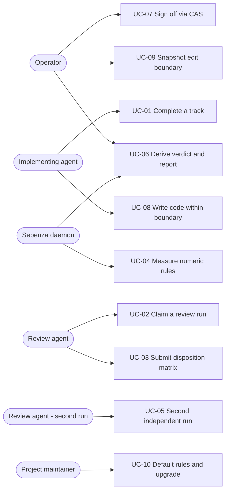
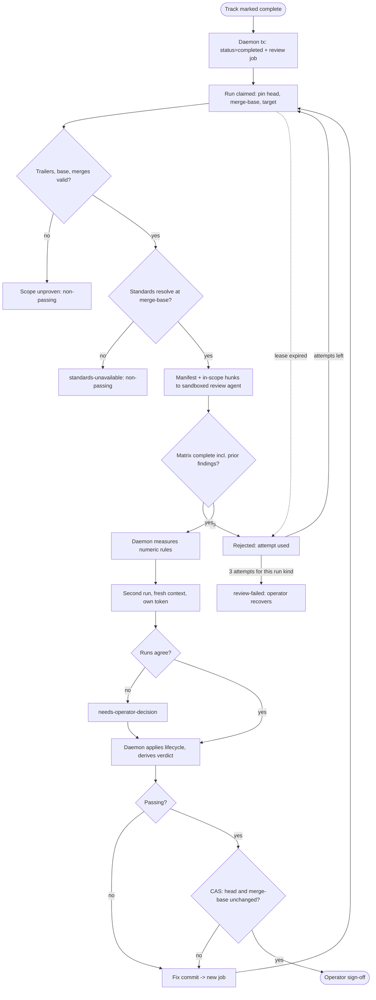
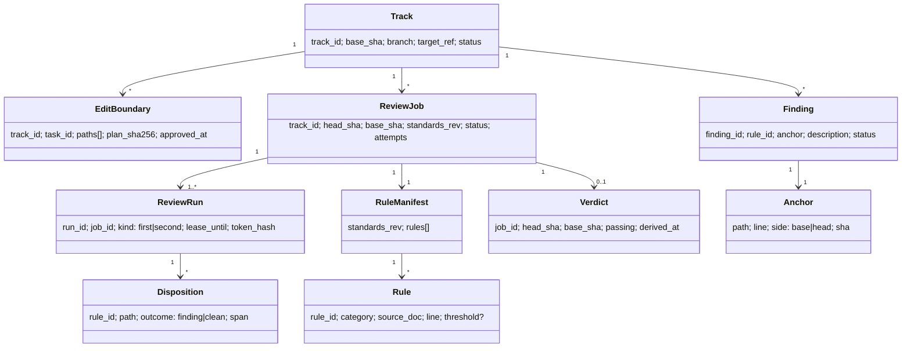
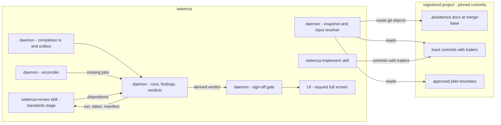

# Design — Standards review at track completion

Track: `standards_review_20261118` · Source: inbox item "sebenza updates" and the operator-approved solution design and handover (`.ai/sebenza/solution-handover.md`).

## Overview
Agent-written code drifts from each project's own standards, over-comments and grows long methods, and nothing checks this when a track finishes. This track makes the daemon own track completion: completion atomically enqueues a standards review that reads pinned git objects only. sebenza-review gains a standards stage with a complete rule-by-file disposition matrix, daemon-measured numeric rules and an independent second run for subjective rules. Only the daemon derives the verdict, and sign-off becomes a compare-and-swap. sebenza-implement gains writing guidance, commit trailers and an edit boundary. AC-07 (full screen) is a separate bug track.

## Actors
- **Operator**: approves plans (snapshotting the edit boundary), decides undecided findings, signs off, accepts standards changes on the target, recovers `review-failed` tracks. Operator token.
- **Implementing agent**: runs sebenza-implement; commits with trailers inside the task's edit boundary; completes the track via the daemon (control token, enqueue only).
- **Review agent (first run)**: runs the sebenza-review standards stage in a sandbox against a claimed run.
- **Review agent (second run)**: an independent fresh-context run for subjective rules.
- **Sebenza daemon** (system): completion transition, reconciler, snapshot resolver, review store, verdict, sign-off gate.
- **Project maintainer**: owns `.ai/sebenza/` standards; accepts default rules via sebenza-setup.

## Use Cases
Seeded by the **Acceptance Criteria** note (items 1–6) and the approved requirements AC-08 and AC-09. AC-07 belongs to the full-screen bug track.

| ID | Use case | Actor | Covers |
|---|---|---|---|
| UC-01 | Complete a track: one fsynced daemon event writes status and review job; `tracks.json` shows `done` | Implementing agent | AC-01 |
| UC-01a | Crash before/after commit, or `done` set outside the daemon; reconciler repairs, never duplicates | Daemon | AC-01 |
| UC-02 | Claim a run: pin head, merge-base, target; verify trailers; resolve standards; build manifest and hunks | Review agent, Daemon | AC-02, AC-08, AC-09 |
| UC-02a | Standards unavailable (escaping path, symlink, submodule, oversized, missing) gives non-passing | Daemon | AC-08 |
| UC-02b | Scope unproven (missing/foreign trailer, foreign merge, missing base, head off branch) | Daemon | AC-09 |
| UC-02c | Track edits `.ai/sebenza/`: `standards-change` finding | Daemon, Operator | AC-02 |
| UC-03 | Submit a complete disposition matrix (every rule x file, every open prior finding) | Review agent | AC-02, AC-03 |
| UC-03a | Incomplete matrix or omitted prior finding is rejected | Daemon | AC-03 |
| UC-04 | Daemon measures numeric rules; a measured breach overrides `clean` | Daemon | AC-06 |
| UC-04a | No parser for the language: rule falls back to the second run | Daemon | AC-06 |
| UC-05 | Second independent run decides subjective (comment) findings | Review agent (second) | AC-06 |
| UC-05a | Runs disagree: `needs-operator-decision`, non-passing; operator decides | Operator | AC-03 |
| UC-06 | Derive verdict and report every finding as resolved or unresolved | Daemon, Operator | AC-03 |
| UC-06a | Lifecycle: rename matching, `resolved-out-of-scope`, `rule-withdrawn` (target only) | Daemon | AC-03 |
| UC-06b | Three failed attempts (lease expiry or rejection) for a run kind: `review-failed` | Daemon | AC-01 |
| UC-07 | Sign off via compare-and-swap on head and merge-base | Operator | AC-01, AC-03 |
| UC-07a | Ref moved since the verdict: sign-off refused | Operator | AC-03 |
| UC-08 | Write code with comment/method guidance, trailers, inside the edit boundary | Implementing agent | AC-04, AC-05, AC-09 |
| UC-08a | Edit outside the task boundary (incl. comment deletion): `out-of-scope-edit` | Daemon | AC-09 |
| UC-09 | Operator approves the plan; daemon snapshots the edit boundary and plan hash | Operator, Daemon | AC-09 |
| UC-10 | Ship default rules in setup templates; upgrade proposes them as a diff | Project maintainer | AC-06, AC-08 |
| UC-10a | Category rule absent: informational note only, never a finding | Daemon | AC-08 |

Diagram is a `flowchart LR` approximation of a UML use-case diagram; alternate flows are omitted from it.

## Activity

## Class

Finding status: `open`, `needs-operator-decision`, `resolved`, `resolved-out-of-scope`, `rule-withdrawn`. Special rule ids: `standards-change`, `out-of-scope-edit`.

## Component
Carried verbatim from the operator-approved solution design (section 2); the UI node is the full-screen bug track.

## Architecture
| Domain | Document | Scope |
|---|---|---|
| Business | [business-architecture.md](./business-architecture.md) | In scope: lifecycle gains daemon-owned completion, review-failed and a gated sign-off |
| Application | [application-architecture.md](./application-architecture.md) | In scope: `track_completion`, `standards_review/` module group, run API, skill changes |
| Technical | [technical-architecture.md](./technical-architecture.md) | In scope: fsynced review log, reconciler, git plumbing, sandbox, measurers; no new crates |
| Data | [data-architecture.md](./data-architecture.md) | In scope: job key, standards revision, finding lifecycle, anchors, classification |
| Security | [security-architecture.md](./security-architecture.md) | In scope: credential split, prompt injection, containment, CAS, redaction |

## Impact Analysis
- `crates/sebenza-server`: new `track_completion` service, reconciler, `standards_review/` (resolver, run store, measurers, verdict, gate), new routes.
- `crates/common`: git adapter gains pinned-object plumbing; per-project review log.
- `frontend/src/lib/api-contract` and `sebenza-cli`: every new route mirrored (CLI/UI parity).
- `skills/skills/sebenza-review`: new standards stage and second run; existing checks unchanged.
- `skills/skills/sebenza-implement`: writing guidance, commit trailers, edit boundary, completion via daemon.
- `skills/skills/sebenza-setup`: default rules for three categories; upgrade proposes them as a diff.
- `skills/skills/sebenza-plan`: plan approval triggers the edit-boundary snapshot.
- This repository's `.ai/sebenza/code_styleguides/`: receives the default rules before rollout.
- `tracks.json` becomes a daemon projection for `completed`; hand edits are repaired.
- Hand-made commits without trailers make scope unproven until the operator adds trailers.

## Open Questions for Refinement
1. Operator: accept the conditional reading of AC-06? (inbox request raised; needed before phase 3)
2. Operator: does "standards" mean only the `.ai/sebenza/` documents listed in `index.md`? (raised)
3. Operator: default method-length limit and unit for the setup template? (raised)
4. Operator: review-agent egress limited to model provider and run API (proposed), or a daemon-side proxy? (raised as inbox comment; gates every sandbox task in the plan)
5. Which review CLIs are supported at launch (`claude` only, or `codex` too) given the no-network probe?
6. Are the defaults acceptable: reconciler every 5 min, 2 workers, 256 KiB blob limit, and per-run hunk and diff caps?
7. What is the operator recovery path from `review-failed`: re-queue, or a manual decision?
8. Is the T-024 residual (a same-uid agent can obtain the operator token) accepted for this release?
9. Retention: findings and verdicts kept 90 days after archive, superseded runs pruned after 30 days?
