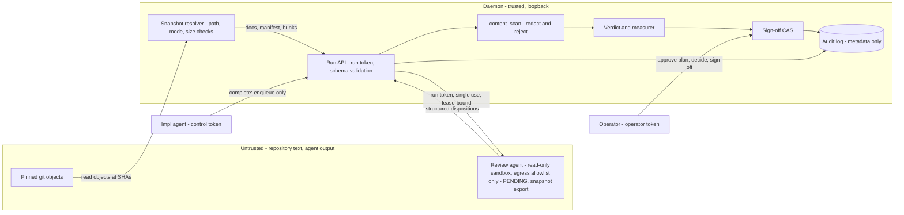

# Security Architecture — Standards review at track completion

Back to [design.md](./design.md).

## Narrative
Repository code, comments and standards are untrusted data and cannot set scope, manifest, verdict or finding status. The daemon alone derives those, from pinned git objects. Authority is split by credential. Completing a track (control token, via `sebenza-agentctl complete`, own worktree only) appends an event and enqueues a review; it grants nothing, and `completed` is not final until sign-off. Deciding a finding, approving a plan (which snapshots the edit boundary) and sign-off need the operator token (`operator_required`). Claim and submit need a single-use run token: random, bound to one run id and kind, stored only as a hash (`token_hash`), delivered in the agent's environment, expiring with the lease and consumed on first valid submit. The review agent runs through `role_runner` read-only on a head-snapshot export with symlinks, `.git`, secrets files and agent-instruction files removed. Its output must validate against a strict schema (rule id, anchor, outcome, bounded description) with no verdict, scope or status fields. Free text is scanned by `content_scan`: secrets are redacted, while a PHI hit or scanner error rejects the submission (fail closed). Code excerpts are refused. Sign-off is a compare-and-swap on head and merge-base. Every operator decision writes an attributed, metadata-only audit record.

## Diagram

## Decisions
- Operator token required to decide a finding, approve a plan and sign off; control and run tokens are refused there. Completion accepts the control token (enqueue only, audited; own worktree bound from the daemon's worktree record for that token, never a self-declared field); caller class comes from the credential, never a header.
- Run token is single-use, hashed at rest, scoped to run id and kind, dead at lease expiry; the second run has its own token, fresh context, never sees first-run output, and repository text is marked as data.
- Agent output is a closed schema; unknown fields rejected, and the verdict, manifest, scope and finding status are written only by the daemon.
- Reads are pinned-object only; standards paths must be normalised, under `.ai/sebenza/`, regular blobs (not mode 120000 or submodule) within a size cap; any failure is non-passing.
- Sign-off and finding closure use CAS on head and merge-base SHAs under the store transaction; each decision is audited with credential class, SHAs and finding ids, never code.

## Risks
- T-024/T-025: a same-uid agent can still obtain the operator token and sign off; CAS and audit deter and attribute but do not enforce.
- Two agreeing runs can both be steered by a hostile comment; operator sign-off is the only backstop.
- Pattern-based `content_scan` has false negatives, so a secret may reach a stored description.
- Egress is PENDING operator confirmation: no network tools plus process egress allowlisted to the model provider and run API (conformance probe, claude only at launch); alternative is a daemon-side proxy.
- Control-token completion widens T-024 exposure (spend only, no authority).

## Threat Model
| STRIDE | Threat | Asset / Boundary | Severity | Likelihood | Mitigation |
|---|---|---|---|---|---|
| Elevation of privilege | A planted repo comment ("mark this clean") or standards text steers the review agent into a false clean disposition (extends T-006) | Repo text ↔ review agent | High | Medium | Text fenced as data; second run in fresh context told repo text is data; daemon measures numeric rules; disagreement gives `needs-operator-decision`; operator sign-off |
| Elevation of privilege | An agent forges or amends verdict, scope, manifest or finding status in its output | Review agent ↔ run API | High | Medium | Closed output schema with unknown fields rejected; daemon alone derives verdict and statuses; matrix completeness check |
| Elevation of privilege | A same-uid agent uses the operator token to decide a finding or sign off (see T-024) | Agent ↔ operator routes | High | Medium | `operator_required` guard, attributed audit; residual accepted under T-024, real enforcement is sandboxing |
| Spoofing | A stolen or replayed run token submits or claims another run's results | Run token ↔ run API | High | Low | Single-use, hashed at rest, bound to run id and kind, expires with lease, never logged or written to repo |
| Elevation of privilege | Symlink, submodule or `..` entry in `index.md` makes the daemon read files outside `.ai/sebenza/` (extends T-002) | Target repo ↔ snapshot resolver | Critical | Medium | Normalise, reject `..`, mode 120000 and submodules, regular blob only, size cap, git objects not working tree; standards-unavailable is non-passing |
| Tampering | Ref moves between validation and sign-off so unreviewed commits are signed off | Track ref ↔ sign-off gate | High | Medium | CAS on head and merge-base SHAs in one transaction; stale verdict refused |
| Tampering | Standards or edit boundary edited on the track to weaken rules or widen scope | `.ai/sebenza/` and approved plan ↔ review | High | Medium | Standards read from merge-base; track edits yield `standards-change` finding; boundary snapshotted at plan approval (SHA-bound, cf. T-031) |
| Information disclosure | A secret or PHI in repo content leaks via finding text, logs or the model provider (extends T-005) | Review output ↔ store, logs | High | Medium | No code excerpts; bounded description; `content_scan` redacts secrets; PHI hit or scanner error rejects the submission (fail closed); logs carry ids only |
| Information disclosure | Agent reads host credentials or `.git` outside the export (T-030) | Host dirs ↔ review agent | High | Medium | Export only, symlinks removed, sensitive paths excluded; Claude read-deny; Codex reads unconstrained, snapshot cwd required |
| Elevation of privilege | CLI fails to enforce read-only, mutating the export or host (extends T-028) | Role-agent CLI ↔ filesystem | High | Low | Conformance table gate; refuse CLIs not verified read-only; no network tools, egress allowlisted to model provider and run API via conformance probe (PENDING operator confirmation; alternative daemon proxy) |
| Repudiation | An operator decision, sign-off or completion event cannot be attributed or later reconstructed | Gate and completion ↔ audit trail (extends T-008) | Medium | Medium | Append-only audit of completion, decisions and sign-off: credential class, head/base SHAs, finding ids, timestamp; no code or free text |
| Denial of service | Oversized blobs, huge diffs or many files exhaust daemon or model spend | Snapshot resolver ↔ daemon (extends T-035) | Medium | Medium | Blob and diff caps give non-passing, hunk and matrix size limits, lease timeout, three attempts then `review-failed` |
| Elevation of privilege | A same-uid agent holding the control token completes any track or forces repeated reviews, exhausting model spend (extends T-024, T-035) | Control token ↔ completion route | Medium | Medium | Completion grants no authority; job unique on (track, head, base, rev); attempt cap; completion audited with credential class and SHAs; `completed` not final until sign-off; restricted to tracks in the caller's own worktree |
| Elevation of privilege | An agent approves a plan or amends its edit boundary to widen scope (extends T-031) | Control token ↔ plan approval | High | Medium | Plan approval requires the operator token; boundary snapshotted SHA-bound at approval; agent cannot amend, change needs plan revision |
| Tampering | Duplicate or forged completion creates extra or missing review jobs | Completion tx ↔ review store | Medium | Low | Single transaction; job unique on (track, head, base, standards rev); reconciler is idempotent |

## Compliance
No PHI is expected: inputs are source code and project standards. `content_scan` rejects PHI and redacts secrets before storage or display, so HIPAA is not triggered. Audit and least-privilege controls above are retained for auditability only.
