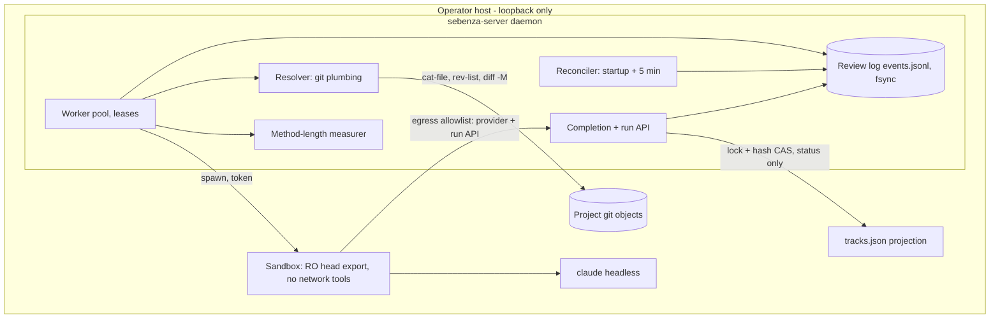

# Technical Architecture — Standards review at track completion

Back to [design.md](./design.md).

## Narrative
Everything runs inside the existing loopback `sebenza-server` daemon; no new process or crate. Skills complete a track through the daemon (`sebenza-agentctl complete`, control token), and the daemon is the only writer of `completed`. It first appends a `track-completed` event (track, head, base, standards revision) to a per-project append-only review log under `~/.ai/sebenza/`, using one `write` plus `sync_data` under a per-log lock inside `spawn_blocking`. That fsync is the commit point. It then projects `status: "done"` (completed maps to done) into `tracks.json`, touching only that track's status and updated_at, under a file lock with a content-hash CAS (re-read and retry on mismatch).

A tokio reconciler runs at startup and every five minutes. It enqueues the job when it sees `done` with no completion event (legacy path or hand edit), pinning the branch head at reconcile time and marking the event `source=reconciled`, or when a completed track's inputs change. It re-applies a missing projection and reaps expired leases. Workers (default 2) claim jobs under leases. The second run is a daemon-scheduled `second` run with its own token and a fresh scratch context, and it never sees first-run output. Attempts are counted per run kind, and three give `review-failed`.

## Diagram

## Decisions
- Review log is the commit point: fsynced event first, then the `tracks.json` projection (hash-CAS, status/updated_at only); the daemon is the sole writer and skills stop writing `done`. On open, truncate (or newline-prefix) a torn last line; fsync the parent directory at creation.
- Counters are separate and log-derived: an attempt is a run ending without an accepted submission (lease expiry or rejection), counted per run kind; lease and attempt events are idempotent, keyed by (job, attempt, lease id).
- Git via `git` CLI plumbing only (`merge-base`, `rev-list --first-parent`, `cat-file --batch`, `diff -M`): reject modes 120000/160000, 256 KiB blob limit, no working-tree reads, `GIT_*` env scrubbed.
- Egress (PENDING operator confirmation; alternative is a daemon-side allowlisting proxy): agent gets no network tools, process egress allowlisted to the CLI's model-provider endpoint and the daemon run API; the conformance probe asserts it. Launch supports `claude` only; `codex` after it passes the probe.
- Method length: in-tree scanners for Rust, TS/JS, Python (no new crates); other languages fall back to the second run. Recovery: startup reconciler rebuilds state from the log; per-track compaction after sign-off bounds growth (see data).

## Risks
- A hand-rolled scanner misreads macros, strings or generics, giving a wrong breach; mitigate with fixtures and a bias to the second run.
- A hand edit or merge of `tracks.json` can diverge from the log; the log is authoritative and the reconciler re-projects, including after an unlocked skill write of other `tracks.json` fields overwrites `done` (accepted residual).
- Large diffs exhaust agent context and cost (two runs); size caps and a clear `review-failed` reason.
- `git` children can hang on huge repos; timeouts, bounded concurrency, no daemon lock held across calls.
- Egress mechanism is unconfirmed; if the CLI cannot be allowlisted, reviews are blocked or need a proxy, trading availability for isolation.
