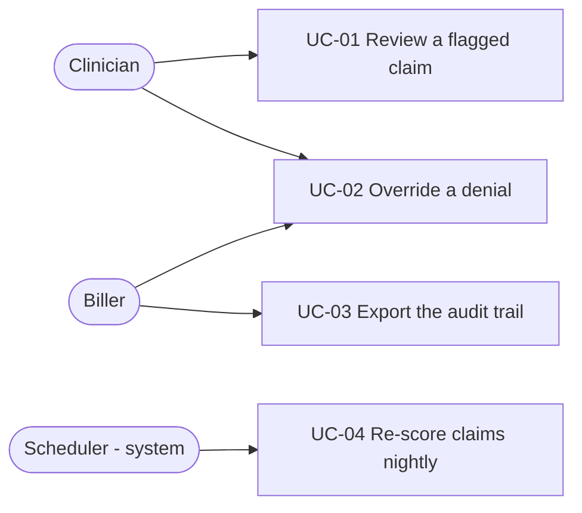
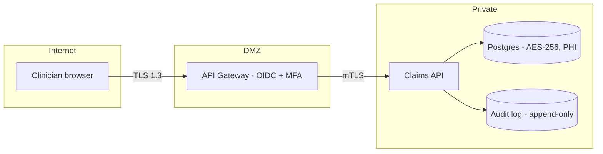

# Diagrams: Mermaid in the Document (shared reference)

> Shared reference for all `sebenza-*` skills. No frontmatter — loaded on demand.

**The document is the review surface.** Every diagram Sebenza produces is drafted straight into the
artifact (`design.md`, `<domain>-architecture.md`, `test-plan.md`, `spec.md`) as a ` ```mermaid `
block, and the user reviews it **there** — in the editor or forge they have open on the worktree,
where Mermaid renders. A terminal renders neither Mermaid nor a reliable sketch, so the user is never
asked to approve a diagram in chat.

## The rule

1. **Draft first, in the file.** Write the first version of the diagram into its section yourself,
   from what you already know (the request, inbox notes, the product docs, the code). Do not ask the
   user to describe the diagram, and do not run a sketch → confirm loop in chat.
2. **Never draw diagrams in chat** — neither ` ```mermaid ` blocks nor ASCII art.
3. **Point, don't paste.** In chat give the file path and section, a ≤ 5-line summary of what the
   diagram claims, and the specific things worth checking (assumptions, anything you were unsure of).
   Then ask the user to review the file and reply with changes or approval.
4. **Revise in place.** Apply feedback to the file, and say what changed in a line or two.
5. **Keep diagram and prose in step.** IDs appear in both (`UC-03a` in the heading *and* the node
   label), so they cannot drift apart. If you change one, change the other before moving on.
6. **Too dense to read?** Split it — e.g. one diagram per actor or per subsystem — rather than ship
   one tangle. More than ~12 nodes or many crossing edges is the usual signal.

Keep labels short; detail belongs in the narrative, not the diagram.

## Patterns by diagram type

| Diagram | Mermaid | Notes |
|---------|---------|-------|
| Use case | `flowchart LR` | Actors on the left as `([Actor])`, use cases as `[UC-01 Title]`. Note in the document that this approximates a UML use-case diagram. Mark system actors. |
| Activity / flow | `flowchart TD` | Decisions as `{eligible?}` with labelled `-- yes -->` / `-- no -->` edges. |
| Class / entities | `classDiagram` | Mark PHI/PII fields inline (e.g. `+UUID patient_id  %% PHI`) — the data and security domains are checked against them. |
| Component / container | `C4Component` or `flowchart LR` with `subgraph` per boundary | Label edges with the protocol (`HTTPS`, `gRPC`, `SQL`). |
| Deployment / technology | `flowchart TB` with nested `subgraph`s | Region → cluster → service; put sizing in labels sparingly. |
| Capability map (business) | `flowchart TB` or `mindmap` | Tag each capability `unchanged` / `CHANGED` / `new`. |
| Data flow with trust boundaries (security) | `flowchart LR` with one `subgraph` per zone | Every edge crossing a subgraph boundary is where the document must say what authenticates and what encrypts. |
| Coverage map (test plan) | `flowchart LR` | `UC-nn` / risk nodes → `TS-nn` nodes. Optional; the traceability **table** is authoritative. A use case with no outgoing edge is the gap it exists to expose. |

### Example — use case



### Example — trust boundaries


